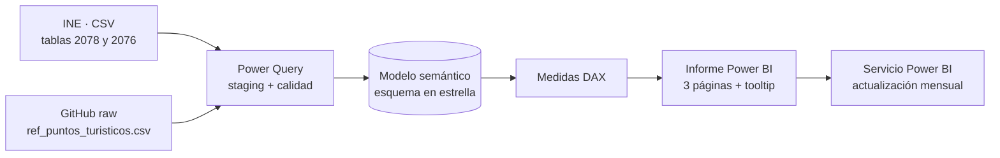
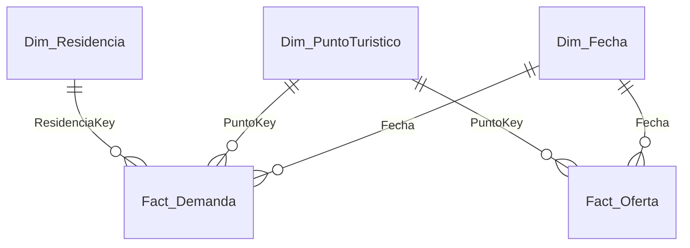
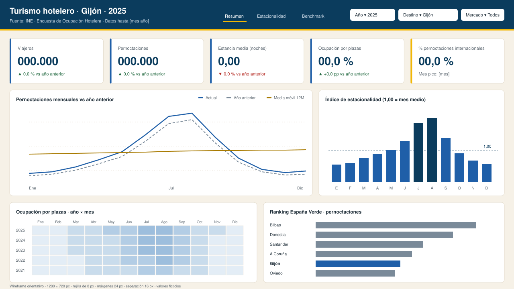

<div align="center">

# 🌊 Turismo Hotelero en Gijón · Dashboard Power BI

**Análisis de la demanda, la oferta y la estacionalidad hotelera de Gijón frente a la España Verde, construido con datos abiertos del INE.**


[Contexto](#-contexto-de-negocio) · [Arquitectura](#-arquitectura) · [Capturas](#-capturas) · [Insights](#-principales-insights) · [Uso](#-cómo-usar-el-proyecto) · [📘 Guía de uso](docs/GUIA_DE_USO.md) · [🛠️ Guía técnica](docs/GUIA_DESARROLLO.md)

</div>

---

> **¿Sólo quieres verlo funcionando?** Descarga el repositorio (*Code > Download ZIP*), extráelo, abre `powerbi/TurismoGijon.pbip` con Power BI Desktop y pulsa **Actualizar**. Paso a paso, con un recorrido por cada página y solución de problemas, en la **[guía de uso](docs/GUIA_DE_USO.md)**.

## 📌 Contexto de negocio

El turismo es uno de los motores económicos de Gijón y su gran reto es **reducir la dependencia de julio y agosto**. Este dashboard ofrece a un perfil de gestión turística (concejalía, asociación hotelera, analista de destino) una visión mensual y comparable de:

| Pregunta de negocio | KPI que la responde |
|---|---|
| ¿Cuánta actividad hotelera genera Gijón y cómo evoluciona? | Viajeros, pernoctaciones, variación interanual y acumulada |
| ¿Se quedan más tiempo los visitantes? | Estancia media (noches por viajero) |
| ¿Se aprovecha la capacidad hotelera? | Grado de ocupación por plazas (ponderado), variación en puntos porcentuales |
| ¿Se está desestacionalizando el destino? | Índice de estacionalidad, % de pernoctaciones en temporada alta, media móvil 12 meses |
| ¿Gana peso el turista internacional? | % de pernoctaciones de residentes en el extranjero |
| ¿Cómo se sitúa Gijón frente a su competencia? | Ranking y cuota frente a Oviedo, Santander, Bilbao, Donostia y A Coruña |

## 🧰 Stack y fuentes

| Capa | Tecnología |
|---|---|
| Ingesta y ETL | Power Query (M) · conexión web parametrizada al INE, funciones reutilizables, consultas de staging y de calidad |
| Modelo | Modelo semántico en importación · esquema en estrella con dos tablas de hechos y dimensiones conformadas |
| Cálculo | DAX · inteligencia de tiempo con patrón "fechas con datos", medidas semiaditivas y ratios ponderados |
| Visualización | Power BI Desktop · tema JSON propio "Gijón Cantábrico" con contraste WCAG AA |
| Versionado | Git + GitHub · formato Power BI Project (PBIP) con TMDL y PBIR |
| Utilidades | Python (biblioteca estándar) para descargar y validar los datos sin conexión |

| Fuente | Contenido | Licencia |
|---|---|---|
| [INE · EOH, tabla 2078](https://datos.gob.es/en/catalogo/ea0010587-viajeros-y-pernoctaciones-por-puntos-turisticos-mensual-municipios-encuesta-de-ocupacion-hotelera-identificador-api-20781) | Viajeros y pernoctaciones por puntos turísticos y residencia (mensual) | [Aviso legal INE](https://www.ine.es/aviso_legal) |
| [INE · EOH, tabla 2076](https://datos.gob.es/gl/catalogo/ea0010587-establecimientos-plazas-estimadas-grados-de-ocupacion-y-personal-empleado-por-puntos-turisticos-mensual-municipios-encuesta-de-ocupacion-hotelera-identificador-api-20761) | Establecimientos, plazas, grados de ocupación y personal por puntos turísticos (mensual) | [Aviso legal INE](https://www.ine.es/aviso_legal) |
| [`ref_puntos_turisticos.csv`](data/reference/ref_puntos_turisticos.csv) | Atributos de los destinos (CCAA, provincia, coordenadas) | MIT (este repositorio) |

> Fuente de los datos: **Instituto Nacional de Estadística (INE)**, Encuesta de Ocupación Hotelera. Elaboración propia.

## 🏗️ Arquitectura

### Flujo de datos



### Modelo de datos (esquema en estrella)



| Tabla | Tipo | Grano |
|---|---|---|
| `Fact_Demanda` | Hechos · aditivos | mes × destino × residencia |
| `Fact_Oferta` | Hechos · instantánea mensual (semiaditivos) | mes × destino |
| `Dim_Fecha` | Calendario (marcada como tabla de fechas) | día |
| `Dim_PuntoTuristico` | Destino | destino |
| `Dim_Residencia` | Mercado emisor | residencia |

Todas las relaciones son **1 : \*** con **filtro cruzado de dirección única**, sin relaciones entre hechos ni bidireccionales. El detalle completo (diccionario, decisiones y configuración) está en la [guía técnica](docs/GUIA_DESARROLLO.md#2-modelado-de-datos-esquema-en-estrella) y en el [diccionario de datos](docs/diccionario_datos.md).

### Medida destacada

```dax
Grado Ocupación Plazas =
// Grado oficial del INE ponderado por plazas-día: reproduce la cifra
// publicada para un mes y agrega correctamente varios meses o destinos.
VAR _Filas =
    FILTER (
        Fact_Oferta,
        NOT ISBLANK ( Fact_Oferta[Grado Ocup Plazas INE] )
            && NOT ISBLANK ( Fact_Oferta[Plazas Dia] )
    )
VAR _Ponderado = SUMX ( _Filas, Fact_Oferta[Grado Ocup Plazas INE] * Fact_Oferta[Plazas Dia] )
VAR _Peso = SUMX ( _Filas, Fact_Oferta[Plazas Dia] )
RETURN
    DIVIDE ( _Ponderado, _Peso )
```

Todas las medidas (más de 30, comentadas y organizadas en carpetas) están en [`src/dax/medidas.dax`](src/dax/medidas.dax), listas para aplicarse desde la Vista de consultas DAX.

## 📸 Capturas

> Sustituye el wireframe por las capturas reales del informe (guárdalas en [`docs/screenshots/`](docs/screenshots/) con los nombres indicados).

| Página | Vista previa |
|---|---|
| **Resumen** · KPIs, tendencia, estacionalidad, mercados y ranking |  <!-- docs/screenshots/01-resumen.png --> |
| **Estacionalidad** · mapa de calor año × mes y temporada alta | <!--  --> *Captura pendiente* |
| **Benchmark** · Gijón frente a la España Verde | <!--  --> *Captura pendiente* |
| **Tooltip** · detalle del mes | <!--  --> *Captura pendiente* |

<!-- Opcional: GIF de navegación →  -->
<!-- Opcional: enlace "Publicar en la web" → [Ver informe interactivo](https://app.powerbi.com/view?r=...) -->

## 💡 Principales insights

> Plantilla: completa cada punto con las cifras del informe tras la primera actualización. Las preguntas y las medidas que las responden ya están definidas.

1. **Estacionalidad.** El **[X] %** de las pernoctaciones anuales se concentra en julio y agosto; el índice de estacionalidad de agosto es **[X,XX]** (1,00 = mes medio).
   *Medidas: `% Pernoctaciones Temporada Alta`, `Índice Estacionalidad`.*
2. **Desestacionalización.** Entre **[año]** y **[año]**, el peso de la temporada alta pasa del **[X] %** al **[X] %**; septiembre se comporta como **[mes de temporada media/alta]**.
   *Medidas: `% Pernoctaciones Temporada Alta` por año, matriz año × mes.*
3. **Tendencia.** La media móvil de 12 meses muestra un **[crecimiento/descenso]** del **[X] %** en el último año, por encima/por debajo de la media de la España Verde (**[X] %**).
   *Medidas: `Pernoctaciones Media Móvil 12M`, `Pernoctaciones Acum Var %`.*
4. **Mercado internacional.** Los residentes en el extranjero suponen el **[X] %** de las pernoctaciones (**[+/−X] pp** frente a **[año]**).
   *Medida: `% Pernoctaciones Internacionales`.*
5. **Eficiencia de la oferta.** El grado de ocupación por plazas es del **[X] %** (**[+/−X] pp** interanual), con una estancia media de **[X,XX]** noches.
   *Medidas: `Grado Ocupación Plazas`, `Grado Ocupación Plazas Var pp`, `Estancia Media`.*
6. **Posición competitiva.** Gijón ocupa el puesto **[N]** de 6 destinos de la España Verde por pernoctaciones, con una cuota del **[X] %**.
   *Medidas: `Ranking Pernoctaciones`, `Cuota Pernoctaciones Selección`.*

## 🚀 Cómo usar el proyecto

### Requisitos

- [Power BI Desktop](https://www.microsoft.com/power-platform/products/power-bi/desktop) (Windows, versión reciente con soporte para PBIP).
- Conexión a Internet (los datos se descargan directamente del INE).
- Opcional: Python 3.9+ para el script de descarga y validación sin conexión.

### Opción A · Abrir el proyecto (recomendado)

El informe completo (modelo, 39 medidas y 3 páginas) está incluido y listo para abrir.

```bash
git clone https://github.com/GITHUB_USER/turismo-gijon-powerbi.git
```

1. Doble clic en `powerbi/TurismoGijon.pbip` (Power BI Desktop).
2. *Inicio > Actualizar*. Credenciales: **Anónimo**; niveles de privacidad: **Público** para el INE y GitHub.
3. Ajusta los parámetros si lo necesitas (*Transformar datos > Editar parámetros*):

| Parámetro | Valor por defecto | Para qué |
|---|---|---|
| `pPuntosTuristicos` | `Gijón;Oviedo;Santander;Bilbao;Coruña;Sebastián` | Destinos a cargar (el primero es el foco) |
| `pFechaInicio` | `01/01/2015` | Inicio del histórico |
| `pTablaDemanda` / `pTablaOferta` | `2078` / `2076` | Tablas del INE |

Cómo leer cada página, tareas habituales (actualizar cada mes, añadir ciudades, publicar, exportar) y solución de problemas: **[guía de uso](docs/GUIA_DE_USO.md)**.

### Opción B · Construirlo desde cero

Sigue la [guía de desarrollo](docs/GUIA_DESARROLLO.md) paso a paso: cada consulta de Power Query está en [`src/power-query/`](src/power-query/), las medidas en [`src/dax/`](src/dax/) y el tema en [`src/theme/`](src/theme/).

### Opción C · Sólo el informe

Descarga el `.pbix` de la última [Release](https://github.com/GITHUB_USER/turismo-gijon-powerbi/releases).

### Datos sin conexión

```bash
python scripts/descargar_datos_ine.py
```

Descarga las tablas del INE en `data/raw/`, genera extractos filtrados en `data/processed/` e informa del último mes publicado y de los destinos encontrados.

## 📁 Estructura del repositorio

```text
├── data/                 # raw (ignorado) · processed · reference
├── docs/                 # guía de uso, guía técnica, diccionario, diseño y capturas
├── powerbi/              # Power BI Project (.pbip · TMDL · PBIR)
├── scripts/              # utilidades de descarga y validación
└── src/
    ├── power-query/      # un .pq por consulta: parámetros, funciones, staging, modelo, calidad
    ├── dax/              # medidas y columnas calculadas
    └── theme/            # tema JSON "Gijón Cantábrico"
```

## ✅ Buenas prácticas aplicadas

- **ETL:** origen web parametrizado y actualizable en el servicio sin puerta de enlace · validación explícita del esquema · nulos reales en lugar de ceros · tipado con referencia cultural · staging sin carga · consulta de control de calidad.
- **Modelo:** esquema en estrella · claves suplentes enteras · relaciones 1:\* de dirección única · tabla de fechas marcada · sin fecha/hora automáticas · columnas técnicas ocultas · tabla de medidas.
- **DAX:** `VAR`/`RETURN` · `DIVIDE` · ratios ponderados · medidas semiaditivas · comparación interanual sólo de meses publicados.
- **Diseño:** tema corporativo validado contra el esquema oficial · contraste WCAG AA · iconos además de color · títulos y texto alternativo dinámicos.
- **Versionado:** PBIP (TMDL + PBIR) · Conventional Commits · releases con el `.pbix`.

## 🗺️ Roadmap

- [x] Diseño de la arquitectura, ETL, modelo, medidas y tema
- [x] Informe completo en PBIP (TMDL + PBIR): 3 páginas, 30 visuales
- [ ] Capturas reales e insights con los datos actualizados
- [ ] Información sobre herramientas de página "Detalle del mes"
- [ ] Publicación en el servicio con actualización programada
- [ ] Rentabilidad hotelera (ADR y RevPAR, INE tablas 46298 / 46301)
- [ ] Apartamentos turísticos (EOAP) como oferta extrahotelera

## 📄 Licencia

Código y documentación bajo licencia [MIT](LICENSE). Los datos pertenecen a sus publicadores (INE) y se reutilizan citando la fuente conforme a sus condiciones.

## 👤 Autor

**GITHUB_USER** · [GitHub](https://github.com/GITHUB_USER) · [LinkedIn](https://www.linkedin.com/in/tu-perfil) <!-- Sustituye por tu perfil -->

*Proyecto de portfolio de Business Intelligence alineado con la certificación Microsoft PL-300 (Power BI Data Analyst).*
