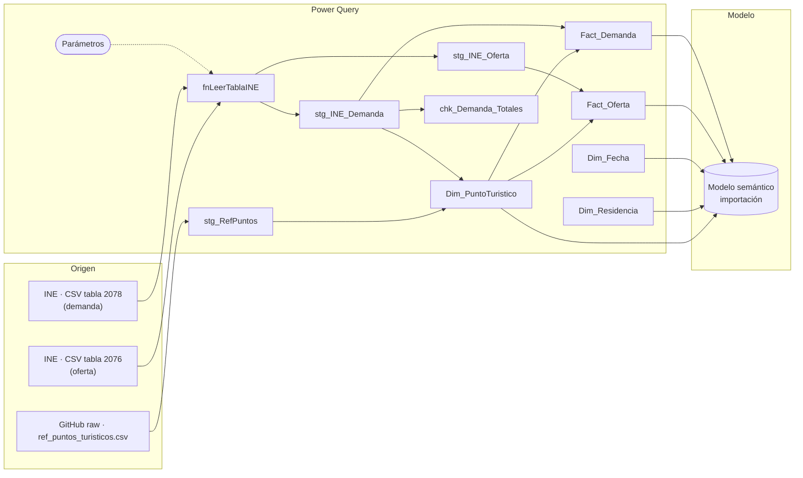
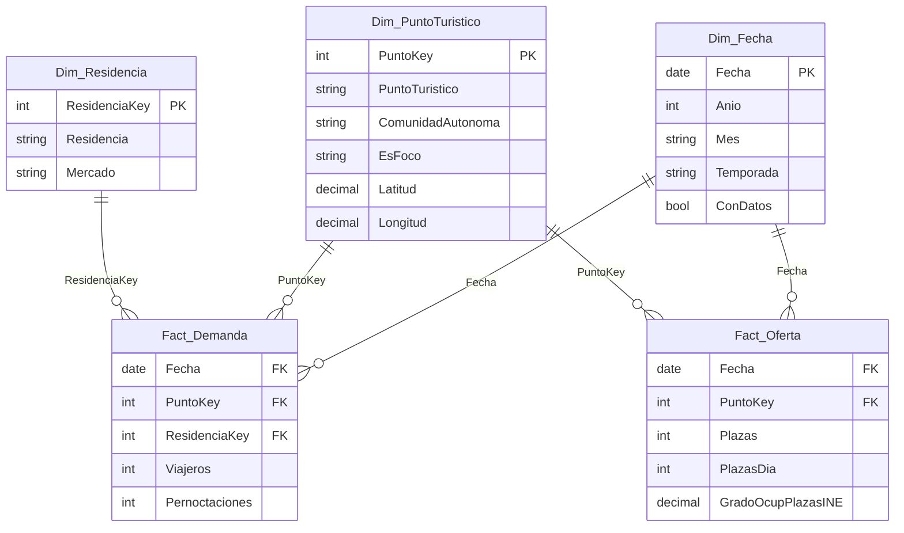
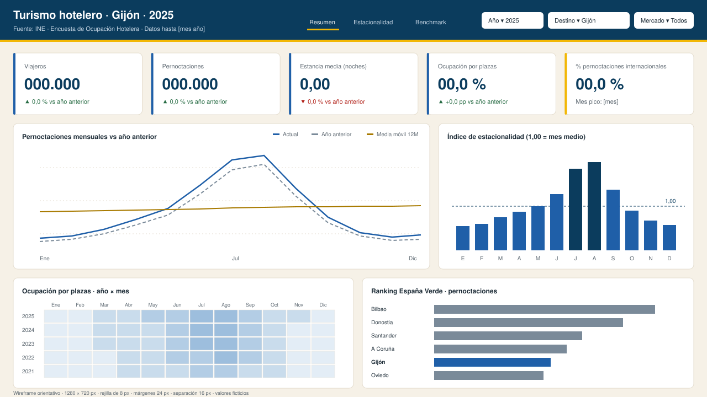

# Guía de desarrollo · Dashboard de Turismo Hotelero en Gijón

> **Rol de referencia:** Arquitecto de datos · Power BI Data Analyst (PL-300)
> **Objetivo:** construir, documentar y versionar un informe de Power BI de nivel profesional con datos abiertos, aplicando las prácticas recomendadas por Microsoft en cada fase.

Esta guía explica el **qué**, el **cómo** y, sobre todo, el **porqué** de cada decisión. El código de cada bloque vive también en [`src/`](../src) (un fichero por consulta o artefacto), que es la implementación de referencia.

> **Atajo:** el resultado final ya está construido en [`powerbi/TurismoGijon.pbip`](../powerbi/TurismoGijon.pbip). Ábrelo con Power BI Desktop y pulsa *Actualizar* (instrucciones en [`powerbi/README.md`](../powerbi/README.md)). Esta guía sirve para entender cada pieza o reconstruirla desde cero.

## Índice

0. [Decisión de alcance](#0-decisión-de-alcance)
1. [Fuente de datos y ETL con Power Query](#1-fuente-de-datos-y-etl-con-power-query)
2. [Modelado de datos: esquema en estrella](#2-modelado-de-datos-esquema-en-estrella)
3. [Medidas DAX](#3-medidas-dax)
4. [Diseño UI/UX del informe](#4-diseño-uiux-del-informe)
5. [Repositorio y control de versiones](#5-repositorio-y-control-de-versiones)
6. [Validación, publicación y checklist PL-300](#6-validación-publicación-y-checklist-pl-300)

---

## 0. Decisión de alcance

Se evaluaron las dos temáticas propuestas con criterios de ingeniería de datos:

| Criterio | Turismo en Gijón | Empleo TIC en Asturias |
|---|---|---|
| Granularidad disponible | **Mensual por municipio** (Gijón es "punto turístico" de la EOH del INE) | Habitualmente regional y anual/trimestral |
| Profundidad histórica | **Serie continua desde 2005** | Series más cortas o con cambios de clasificación sectorial |
| Formato y acceso | **CSV y API JSON estables**, URL fija por tabla | Con frecuencia tablas de presentación (Excel/PDF) que requieren limpieza manual |
| Actualización | **Mensual**, calendario oficial | Variable según la fuente |
| Riqueza analítica | Estacionalidad, mercados emisores, oferta vs. demanda, benchmark entre ciudades | Menos dimensiones cruzables a nivel municipal |

**Decisión: Turismo hotelero en Gijón.** Es la opción con datos más limpios, más granulares y con actualización automática. Además, es la misma fuente que el Ayuntamiento de Gijón utiliza en sus balances turísticos públicos, lo que permite validar los resultados contra cifras oficiales publicadas.

---

## 1. Fuente de datos y ETL con Power Query

### 1.1 Inventario de fuentes

| # | Conjunto de datos | Publicador · licencia | Uso en el modelo | Grano | Acceso |
|---|---|---|---|---|---|
| 1 | **EOH · Viajeros y pernoctaciones por puntos turísticos** (tabla `2078`) | INE · aviso legal INE (reutilización citando la fuente) | `Fact_Demanda` | mes × punto × residencia | [CSV](https://www.ine.es/jaxiT3/files/t/csv_bdsc/2078.csv) · [JSON](https://servicios.ine.es/wstempus/js/es/DATOS_TABLA/2078?tip=AM) · [ficha en datos.gob.es](https://datos.gob.es/en/catalogo/ea0010587-viajeros-y-pernoctaciones-por-puntos-turisticos-mensual-municipios-encuesta-de-ocupacion-hotelera-identificador-api-20781) |
| 2 | **EOH · Establecimientos, plazas estimadas, grados de ocupación y personal empleado por puntos turísticos** (tabla `2076`) | INE | `Fact_Oferta` | mes × punto | [CSV](https://www.ine.es/jaxiT3/files/t/csv_bdsc/2076.csv) · [ficha en datos.gob.es](https://datos.gob.es/gl/catalogo/ea0010587-establecimientos-plazas-estimadas-grados-de-ocupacion-y-personal-empleado-por-puntos-turisticos-mensual-municipios-encuesta-de-ocupacion-hotelera-identificador-api-20761) |
| 3 | **Referencia de destinos** (CCAA, provincia, coordenadas, orden, foco) | Elaboración propia · este repositorio | `Dim_PuntoTuristico` | destino | [`data/reference/ref_puntos_turisticos.csv`](../data/reference/ref_puntos_turisticos.csv) |
| Ampliación | IRSH · ADR (tabla `46298`) y RevPAR (tabla `46301`) por puntos turísticos | INE | Rentabilidad hotelera (fase 2) | mes × punto | [ficha ADR](https://datos.gob.es/eu/catalogo/ea0010587-tarifa-media-diaria-adr-desglose-por-puntos-turisticos-mensual-municipios-indicadores-de-rentabilidad-del-sector-hotelero-identificador-api-46298.ttl) |
| Ampliación | Catálogo de datos de Turismo de Asturias (recursos y alojamientos) | Principado de Asturias · CC BY 4.0 | Contexto de oferta regional | recurso | [turismoasturias.es/open-data](https://www.turismoasturias.es/en/open-data) |
| Ampliación | Portal de datos abiertos del Ayuntamiento de Gijón | Ayuntamiento de Gijón · CC BY 4.0 | Contexto local | variable | [datos.gijon.es](http://datos.gijon.es/) |

> **Nota de mantenimiento.** El INE ha empezado a publicar algunas tablas con identificadores nuevos (por ejemplo, `75198` para establecimientos, plazas y grados de ocupación por puntos turísticos). Los IDs son **parámetros** del proyecto: si una tabla deja de actualizarse, basta con cambiar `pTablaOferta` o `pTablaDemanda`. En la ficha de datos.gob.es de la tabla `2078` (abril de 2026) figuraban datos hasta marzo de 2026, publicados el 23 de abril: el INE difunde la EOH, aproximadamente, a final del mes siguiente.

**Por qué el benchmark de la España Verde.** Analizar un único destino sólo permite compararlo consigo mismo. Cargar Oviedo, Santander, Bilbao, Donostia-San Sebastián y A Coruña añade contexto ("¿crece Gijón más o menos que su competencia directa?") sin cambiar el grano del modelo.

### 1.2 Arquitectura de ingesta



**Convenciones de nombres y grupos de consultas** (Editor de Power Query > clic derecho > *Mover a grupo*):

| Grupo | Prefijo | Ejemplo | ¿Habilitar carga? |
|---|---|---|---|
| `00 Parámetros` | `p` | `pTablaDemanda` | No |
| `01 Funciones` | `fn` | `fnLeerTablaINE` | No |
| `02 Staging` | `stg_` | `stg_INE_Demanda` | **No** |
| `03 Modelo` | `Dim_` / `Fact_` | `Fact_Demanda` | **Sí** |
| `99 Calidad` | `chk_` | `chk_Demanda_Totales` | No |

Desactivar la carga de las consultas intermedias (clic derecho > *Habilitar carga*) evita tablas duplicadas en el modelo: sólo se cargan dimensiones y hechos.

### 1.3 Parámetros

Crea cada parámetro en *Inicio > Administrar parámetros > Nuevo parámetro*, o como consulta en blanco pegando el código en el *Editor avanzado* (el nombre de la consulta es el nombre del fichero).

**`pINE_BaseUrl`** · [`src/power-query/parametros/pINE_BaseUrl.pq`](../src/power-query/parametros/pINE_BaseUrl.pq)

```powerquery
// Parámetro · URL base del INE (estática para permitir la actualización en el servicio)
"https://www.ine.es" meta [IsParameterQuery = true, Type = "Text", IsParameterQueryRequired = true]
```
**`pTablaDemanda`** · [`src/power-query/parametros/pTablaDemanda.pq`](../src/power-query/parametros/pTablaDemanda.pq)

```powerquery
// Parámetro · ID de tabla INEbase: EOH · Viajeros y pernoctaciones por puntos turísticos (mensual)
"2078" meta [IsParameterQuery = true, Type = "Text", IsParameterQueryRequired = true]
```
**`pTablaOferta`** · [`src/power-query/parametros/pTablaOferta.pq`](../src/power-query/parametros/pTablaOferta.pq)

```powerquery
// Parámetro · ID de tabla INEbase: EOH · Establecimientos, plazas estimadas, grados de ocupación
// y personal empleado por puntos turísticos (mensual).
// Si el INE deja de actualizar la 2076, sustituir por el nuevo identificador publicado (p. ej. 75198).
"2076" meta [IsParameterQuery = true, Type = "Text", IsParameterQueryRequired = true]
```
**`pPuntosTuristicos`** · [`src/power-query/parametros/pPuntosTuristicos.pq`](../src/power-query/parametros/pPuntosTuristicos.pq)

```powerquery
// Parámetro · Patrones (separados por ';') de los puntos turísticos a cargar.
// El primero es el destino foco; el resto forman el benchmark de la España Verde.
"Gijón;Oviedo;Santander;Bilbao;Coruña;Sebastián" meta [IsParameterQuery = true, Type = "Text", IsParameterQueryRequired = true]
```
**`pFechaInicio`** · [`src/power-query/parametros/pFechaInicio.pq`](../src/power-query/parametros/pFechaInicio.pq)

```powerquery
// Parámetro · Primer mes del histórico que se carga en el modelo
#date(2015, 1, 1) meta [IsParameterQuery = true, Type = "Date", IsParameterQueryRequired = true]
```
**`pGitHubRawBase`** · [`src/power-query/parametros/pGitHubRawBase.pq`](../src/power-query/parametros/pGitHubRawBase.pq)

```powerquery
// Parámetro · Host de contenido "raw" de GitHub (URL base estática)
"https://raw.githubusercontent.com" meta [IsParameterQuery = true, Type = "Text", IsParameterQueryRequired = true]
```
**`pRutaReferencia`** · [`src/power-query/parametros/pRutaReferencia.pq`](../src/power-query/parametros/pRutaReferencia.pq)

```powerquery
// Parámetro · Ruta relativa del CSV de referencia versionado en este repositorio
"alejandrodomingo05-debug/turismo-gijon-powerbi/main/data/reference/ref_puntos_turisticos.csv" meta [IsParameterQuery = true, Type = "Text", IsParameterQueryRequired = true]
```

### 1.4 Funciones reutilizables

`fnLeerTablaINE` encapsula el acceso al INE. El detalle clave para el servicio de Power BI: **la URL base es estática y la parte variable va en `RelativePath`**. Si se concatenase la URL completa, el servicio no podría validar el origen y rechazaría la actualización programada ("origen de datos dinámico").

**`fnLeerTablaINE`** · [`src/power-query/funciones/fnLeerTablaINE.pq`](../src/power-query/funciones/fnLeerTablaINE.pq)

```powerquery
// =====================================================================
//  fnLeerTablaINE
//  Descarga una tabla de INEbase en formato CSV (separador ';') y la
//  devuelve con las cabeceras promovidas.
//
//  Buenas prácticas aplicadas
//  · Web.Contents con URL base ESTÁTICA (parámetro) + RelativePath:
//    el servicio de Power BI puede validar el origen y programar la
//    actualización sin errores de "origen de datos dinámico".
//  · Encoding 65001 (UTF-8). Si las tildes salen corruptas, usar 1252.
//  · Timeout explícito: el CSV completo de la EOH pesa varios MB.
// =====================================================================
(idTabla as text) as table =>
let
    Binario = Web.Contents(
        pINE_BaseUrl,
        [
            RelativePath = "jaxiT3/files/t/csv_bdsc/" & idTabla & ".csv",
            Timeout = #duration(0, 0, 5, 0)
        ]
    ),
    Csv = Csv.Document(
        Binario,
        [Delimiter = ";", Encoding = 65001, QuoteStyle = QuoteStyle.Csv]
    ),
    ConCabeceras = Table.PromoteHeaders(Csv, [PromoteAllScalars = true])
in
    ConCabeceras
```

`fnRenombrarPorPatron` renombra columnas por coincidencia parcial. Si el INE cambia "Puntos turísticos" por "Punto turístico", el ETL sigue funcionando; si una columna desaparece, falla con un mensaje explícito en lugar de cargar datos incorrectos en silencio.

**`fnRenombrarPorPatron`** · [`src/power-query/funciones/fnRenombrarPorPatron.pq`](../src/power-query/funciones/fnRenombrarPorPatron.pq)

```powerquery
// =====================================================================
//  fnRenombrarPorPatron
//  Renombra columnas buscando un patrón (sin distinguir mayúsculas)
//  en lugar del nombre exacto. Hace el ETL resiliente a cambios menores
//  de redacción en las cabeceras del INE y falla con un error claro
//  si una columna esperada desaparece.
//
//  Uso: fnRenombrarPorPatron(tabla, {{"punto", "PuntoTuristico"}, {"periodo", "Periodo"}})
// =====================================================================
(tabla as table, mapeo as list) as table =>
let
    Columnas = Table.ColumnNames(tabla),
    Pares = List.Transform(
        mapeo,
        (par as list) =>
            let
                Coincidencias = List.Select(
                    Columnas,
                    each Text.Contains(_, par{0}, Comparer.OrdinalIgnoreCase)
                ),
                Encontrada =
                    if List.IsEmpty(Coincidencias) then
                        error Error.Record(
                            "EsquemaINE",
                            "No existe ninguna columna que contenga '" & par{0} & "'",
                            Columnas
                        )
                    else
                        Coincidencias{0}
            in
                {Encontrada, par{1}}
    ),
    Resultado = Table.RenameColumns(tabla, Pares)
in
    Resultado
```

**`fnFechaDesdePeriodoINE`** · [`src/power-query/funciones/fnFechaDesdePeriodoINE.pq`](../src/power-query/funciones/fnFechaDesdePeriodoINE.pq)

```powerquery
// =====================================================================
//  fnFechaDesdePeriodoINE
//  Convierte el código de periodo mensual del INE ("2024M03") en la
//  fecha del primer día del mes (01/03/2024). Devuelve null para
//  periodos no mensuales (anuales, trimestrales...), lo que permite
//  usarla también como filtro.
// =====================================================================
(periodo as nullable text) as nullable date =>
    if periodo <> null
        and Text.Length(Text.Trim(periodo)) = 7
        and Text.At(Text.Trim(periodo), 4) = "M"
    then
        #date(
            Number.From(Text.Start(Text.Trim(periodo), 4)),
            Number.From(Text.End(Text.Trim(periodo), 2)),
            1
        )
    else
        null
```

### 1.5 Consultas de staging

Las consultas `stg_` traducen el formato del INE a un formato limpio, tipado y con vocabulario controlado. **No se cargan al modelo.**

**`stg_INE_Demanda`** · [`src/power-query/staging/stg_INE_Demanda.pq`](../src/power-query/staging/stg_INE_Demanda.pq)

```powerquery
// =====================================================================
//  stg_INE_Demanda  ·  Staging (Habilitar carga: NO)
//  Origen : INE · EOH · Viajeros y pernoctaciones por puntos turísticos
//  Grano  : punto turístico × residencia × mes
//  Salida : PuntoTuristico | Residencia | Fecha | Viajeros | Pernoctaciones
// =====================================================================
let
    Origen = fnLeerTablaINE(pTablaDemanda),

    // 1) Nombres de columna estables (independientes de la redacción del INE)
    Renombrado = fnRenombrarPorPatron(
        Origen,
        {
            {"punto", "PuntoTuristico"},
            {"resid", "Residencia"},
            {"periodo", "Periodo"},
            {"total", "Valor"}
        }
    ),
    //    La columna restante es la de la medida ("Viajeros y pernoctaciones").
    //    Si el INE añade dimensiones nuevas, fallamos de forma explícita.
    Restantes = List.Difference(
        Table.ColumnNames(Renombrado),
        {"PuntoTuristico", "Residencia", "Periodo", "Valor"}
    ),
    ColMedida =
        if List.Count(Restantes) = 1 then
            Restantes{0}
        else
            error Error.Record(
                "EsquemaINE",
                "Se esperaba 1 columna de medida y hay " & Text.From(List.Count(Restantes)),
                Restantes
            ),
    ConMedida = Table.RenameColumns(Renombrado, {{ColMedida, "Medida"}}),

    // 2) Filtrar cuanto antes: sólo los puntos de interés y periodos mensuales
    //    (el CSV no admite plegado de consultas: filtrar pronto reduce memoria)
    Patrones = List.Transform(Text.Split(pPuntosTuristicos, ";"), Text.Trim),
    SoloPuntos = Table.SelectRows(
        ConMedida,
        each List.AnyTrue(
            List.Transform(
                Patrones,
                (p) => Text.Contains([PuntoTuristico], p, Comparer.OrdinalIgnoreCase)
            )
        )
    ),
    ConFecha = Table.AddColumn(
        SoloPuntos,
        "Fecha",
        each fnFechaDesdePeriodoINE([Periodo]),
        type nullable date
    ),
    SoloMensual = Table.SelectRows(ConFecha, each [Fecha] <> null),

    // 3) Valor: formato es-ES (1.234,5) y ".." / vacío = dato no disponible
    ValorLimpio = Table.TransformColumns(
        SoloMensual,
        {
            {
                "Valor",
                each if _ = null or List.Contains({"", ".", ".."}, Text.Trim(_)) then null else Text.Trim(_),
                type nullable text
            }
        }
    ),
    ValorNumerico = Table.TransformColumnTypes(ValorLimpio, {{"Valor", type number}}, "es-ES"),

    // 4) Normalizar etiquetas a un vocabulario controlado
    Normalizado = Table.TransformColumns(
        ValorNumerico,
        {
            {"PuntoTuristico", Text.Trim, type text},
            {
                "Medida",
                each
                    if Text.Contains(_, "viajer", Comparer.OrdinalIgnoreCase) then "Viajeros"
                    else if Text.Contains(_, "pernoct", Comparer.OrdinalIgnoreCase) then "Pernoctaciones"
                    else null,
                type nullable text
            },
            {
                "Residencia",
                each
                    if Text.Contains(_, "extranj", Comparer.OrdinalIgnoreCase) then "Extranjero"
                    else if Text.Contains(_, "espa", Comparer.OrdinalIgnoreCase) then "España"
                    else "Total",
                type text
            }
        }
    ),
    SoloMedidasConocidas = Table.SelectRows(Normalizado, each [Medida] <> null),

    // 5) Pivotar medidas a columnas: 1 fila = punto × residencia × mes
    SinPeriodo = Table.RemoveColumns(SoloMedidasConocidas, {"Periodo"}),
    Pivotado = Table.Pivot(
        SinPeriodo,
        {"Viajeros", "Pernoctaciones"},
        "Medida",
        "Valor",
        List.Sum
    ),

    // 6) Tipado final explícito
    Tipado = Table.TransformColumnTypes(
        Pivotado,
        {
            {"PuntoTuristico", type text},
            {"Residencia", type text},
            {"Fecha", type date},
            {"Viajeros", Int64.Type},
            {"Pernoctaciones", Int64.Type}
        }
    )
in
    Tipado
```

**`stg_INE_Oferta`** · [`src/power-query/staging/stg_INE_Oferta.pq`](../src/power-query/staging/stg_INE_Oferta.pq)

```powerquery
// =====================================================================
//  stg_INE_Oferta  ·  Staging (Habilitar carga: NO)
//  Origen : INE · EOH · Establecimientos, plazas estimadas, grados de
//           ocupación y personal empleado por puntos turísticos
//  Grano  : punto turístico × mes
//  Salida : PuntoTuristico | Fecha | Establecimientos | Habitaciones |
//           Plazas | PersonalEmpleado | GradoOcup* (en tanto por uno)
// =====================================================================
let
    Origen = fnLeerTablaINE(pTablaOferta),

    // 1) Nombres de columna estables
    Renombrado = fnRenombrarPorPatron(
        Origen,
        {
            {"punto", "PuntoTuristico"},
            {"periodo", "Periodo"},
            {"total", "Valor"}
        }
    ),
    Restantes = List.Difference(
        Table.ColumnNames(Renombrado),
        {"PuntoTuristico", "Periodo", "Valor"}
    ),
    ColMedida =
        if List.Count(Restantes) = 1 then
            Restantes{0}
        else
            error Error.Record(
                "EsquemaINE",
                "Se esperaba 1 columna de medida y hay " & Text.From(List.Count(Restantes)),
                Restantes
            ),
    ConMedida = Table.RenameColumns(Renombrado, {{ColMedida, "Medida"}}),

    // 2) Filtrar cuanto antes
    Patrones = List.Transform(Text.Split(pPuntosTuristicos, ";"), Text.Trim),
    SoloPuntos = Table.SelectRows(
        ConMedida,
        each List.AnyTrue(
            List.Transform(
                Patrones,
                (p) => Text.Contains([PuntoTuristico], p, Comparer.OrdinalIgnoreCase)
            )
        )
    ),
    ConFecha = Table.AddColumn(
        SoloPuntos,
        "Fecha",
        each fnFechaDesdePeriodoINE([Periodo]),
        type nullable date
    ),
    SoloMensual = Table.SelectRows(ConFecha, each [Fecha] <> null),

    // 3) Valor numérico (formato es-ES; ".." = no disponible)
    ValorLimpio = Table.TransformColumns(
        SoloMensual,
        {
            {
                "Valor",
                each if _ = null or List.Contains({"", ".", ".."}, Text.Trim(_)) then null else Text.Trim(_),
                type nullable text
            }
        }
    ),
    ValorNumerico = Table.TransformColumnTypes(ValorLimpio, {{"Valor", type number}}, "es-ES"),

    // 4) Vocabulario controlado de medidas (el orden de las reglas importa)
    ConMedidaStd = Table.AddColumn(
        ValorNumerico,
        "MedidaStd",
        each
            let
                m = Text.Lower([Medida])
            in
                if Text.Contains(m, "fin de semana") then "GradoOcupPlazasFinSemana"
                else if Text.Contains(m, "ponderad") then "GradoOcupPlazasPonderado"
                else if Text.Contains(m, "ocupaci") and Text.Contains(m, "habitaci") then "GradoOcupHabitaciones"
                else if Text.Contains(m, "ocupaci") and Text.Contains(m, "plaza") then "GradoOcupPlazas"
                else if Text.Contains(m, "establecimiento") then "Establecimientos"
                else if Text.Contains(m, "habitaci") then "Habitaciones"
                else if Text.Contains(m, "plaza") then "Plazas"
                else if Text.Contains(m, "personal") then "PersonalEmpleado"
                else null,
        type nullable text
    ),
    SoloMedidasConocidas = Table.SelectRows(ConMedidaStd, each [MedidaStd] <> null),

    // 5) Pivotar: 1 fila = punto × mes
    Columnas = Table.SelectColumns(SoloMedidasConocidas, {"PuntoTuristico", "Fecha", "MedidaStd", "Valor"}),
    Pivotado = Table.Pivot(
        Columnas,
        {
            "Establecimientos", "Habitaciones", "Plazas", "PersonalEmpleado",
            "GradoOcupPlazas", "GradoOcupPlazasFinSemana", "GradoOcupPlazasPonderado", "GradoOcupHabitaciones"
        },
        "MedidaStd",
        "Valor",
        List.Sum
    ),

    // 6) Ratios en tanto por uno (26,5 -> 0,265): se formatean como % en el modelo
    RatiosDecimales = Table.TransformColumns(
        Pivotado,
        {
            {"GradoOcupPlazas", each if _ = null then null else _ / 100, Percentage.Type},
            {"GradoOcupPlazasFinSemana", each if _ = null then null else _ / 100, Percentage.Type},
            {"GradoOcupPlazasPonderado", each if _ = null then null else _ / 100, Percentage.Type},
            {"GradoOcupHabitaciones", each if _ = null then null else _ / 100, Percentage.Type}
        }
    ),

    // 7) Tipado final explícito
    Tipado = Table.TransformColumnTypes(
        RatiosDecimales,
        {
            {"PuntoTuristico", type text},
            {"Fecha", type date},
            {"Establecimientos", Int64.Type},
            {"Habitaciones", Int64.Type},
            {"Plazas", Int64.Type},
            {"PersonalEmpleado", Int64.Type}
        }
    )
in
    Tipado
```

`stg_RefPuntos` es la **única** consulta que accede a GitHub. Separarla no es estético: si `Dim_PuntoTuristico` leyera la web directamente y además referenciara `stg_INE_Demanda`, Power Query lanzaría el error **Formula.Firewall** (*"Query references other queries or steps, so it may not directly access a data source"*). Regla práctica: una consulta **o** accede a orígenes **o** combina otras consultas, nunca ambas cosas. Además, si el repositorio no está accesible, usa una copia incrustada y el informe carga igualmente.

**`stg_RefPuntos`** · [`src/power-query/staging/stg_RefPuntos.pq`](../src/power-query/staging/stg_RefPuntos.pq)

```powerquery
// =====================================================================
//  stg_RefPuntos  ·  Staging (Habilitar carga: NO)
//  Atributos de referencia de los destinos (CCAA, provincia, coordenadas,
//  orden, foco), versionados en data/reference/ref_puntos_turisticos.csv.
//
//  · Esta consulta es la ÚNICA que accede a GitHub. Dim_PuntoTuristico la
//    referencia en lugar de leer la web directamente: una consulta que
//    referencia otras consultas y además accede a un origen provoca el
//    error Formula.Firewall ("rebuild this data combination").
//  · Si el repositorio no está accesible (sin conexión, repo privado o aún
//    no publicado) se usa la copia incrustada: el informe siempre carga.
// =====================================================================
let
    // Table.Buffer fuerza la descarga DENTRO del try: sin él, M evalúa la
    // tabla de forma diferida y un error 404 escaparía al otherwise.
    Remota =
        try
            Table.Buffer(
                Table.PromoteHeaders(
                    Csv.Document(
                        Web.Contents(pGitHubRawBase, [RelativePath = pRutaReferencia]),
                        [Delimiter = ",", Encoding = 65001, QuoteStyle = QuoteStyle.Csv]
                    ),
                    [PromoteAllScalars = true]
                )
            )
        otherwise
            null,
    Incrustada = #table(
        {"Patron", "NombreCorto", "ComunidadAutonoma", "Provincia", "EsFoco", "Latitud", "Longitud", "Orden"},
        {
            {"Gijón", "Gijón", "Principado de Asturias", "Asturias", "Sí", "43.5322", "-5.6611", "1"},
            {"Oviedo", "Oviedo", "Principado de Asturias", "Asturias", "No", "43.3614", "-5.8494", "2"},
            {"Santander", "Santander", "Cantabria", "Cantabria", "No", "43.4623", "-3.8100", "3"},
            {"Bilbao", "Bilbao", "País Vasco", "Bizkaia", "No", "43.2630", "-2.9350", "4"},
            {"Sebastián", "Donostia-San Sebastián", "País Vasco", "Gipuzkoa", "No", "43.3183", "-1.9812", "5"},
            {"Coruña", "A Coruña", "Galicia", "A Coruña", "No", "43.3623", "-8.4115", "6"}
        }
    ),
    Origen =
        if Remota <> null and Table.HasColumns(Remota, {"Patron", "NombreCorto", "Orden"}) then
            Remota
        else
            Incrustada,
    Tipado = Table.TransformColumnTypes(
        Origen,
        {
            {"Patron", type text},
            {"NombreCorto", type text},
            {"ComunidadAutonoma", type text},
            {"Provincia", type text},
            {"EsFoco", type text},
            {"Latitud", type number},
            {"Longitud", type number},
            {"Orden", Int64.Type}
        },
        "en-US"
    )
in
    Tipado
```

### 1.6 Dimensiones y hechos

**`Dim_Fecha`** · [`src/power-query/modelo/Dim_Fecha.pq`](../src/power-query/modelo/Dim_Fecha.pq)

```powerquery
// =====================================================================
//  Dim_Fecha  ·  Dimensión calendario (grano: día)
//  · Contigua, desde el 1 de enero del año de pFechaInicio hasta el
//    31 de diciembre del año en curso (requisito de las funciones de
//    inteligencia de tiempo).
//  · Marcar como tabla de fechas en el modelo (columna Fecha).
//  · Los hechos son mensuales (día 1 de cada mes): se relacionan por Fecha.
// =====================================================================
let
    FechaInicio = Date.StartOfYear(pFechaInicio),
    FechaFin = Date.EndOfYear(Date.From(DateTime.LocalNow())),
    NumDias = Duration.Days(FechaFin - FechaInicio) + 1,
    ListaFechas = List.Dates(FechaInicio, NumDias, #duration(1, 0, 0, 0)),
    Tabla = Table.FromList(ListaFechas, Splitter.SplitByNothing(), {"Fecha"}),
    Tipada = Table.TransformColumnTypes(Tabla, {{"Fecha", type date}}),

    // Atributos de calendario (nombres de negocio, en español)
    Anio = Table.AddColumn(Tipada, "Año", each Date.Year([Fecha]), Int64.Type),
    MesNum = Table.AddColumn(Anio, "Mes Num", each Date.Month([Fecha]), Int64.Type),
    Mes = Table.AddColumn(MesNum, "Mes", each Text.Proper(Date.MonthName([Fecha], "es-ES")), type text),
    MesCorto = Table.AddColumn(Mes, "Mes Corto", each Text.Start([Mes], 3), type text),
    Trimestre = Table.AddColumn(MesCorto, "Trimestre", each "T" & Text.From(Date.QuarterOfYear([Fecha])), type text),
    AnioMesNum = Table.AddColumn(Trimestre, "AñoMes Num", each Date.Year([Fecha]) * 100 + Date.Month([Fecha]), Int64.Type),
    MesAnio = Table.AddColumn(AnioMesNum, "Mes Año", each [Mes Corto] & " " & Text.From([Año]), type text),
    InicioMes = Table.AddColumn(MesAnio, "Inicio Mes", each Date.StartOfMonth([Fecha]), type date),
    DiasMes = Table.AddColumn(InicioMes, "Días Mes", each Date.DaysInMonth([Fecha]), Int64.Type),

    // Temporada turística de Gijón (sol y playa del Cantábrico)
    Temporada = Table.AddColumn(
        DiasMes,
        "Temporada",
        each
            if List.Contains({7, 8}, [Mes Num]) then "Alta"
            else if List.Contains({6, 9}, [Mes Num]) then "Media"
            else "Baja",
        type text
    ),
    TemporadaOrden = Table.AddColumn(
        Temporada,
        "Temporada Orden",
        each if [Temporada] = "Alta" then 1 else if [Temporada] = "Media" then 2 else 3,
        Int64.Type
    )
in
    TemporadaOrden
```

**`Dim_PuntoTuristico`** · [`src/power-query/modelo/Dim_PuntoTuristico.pq`](../src/power-query/modelo/Dim_PuntoTuristico.pq)

```powerquery
// =====================================================================
//  Dim_PuntoTuristico  ·  Dimensión de destino (grano: punto turístico)
//  · Los miembros salen de los datos (lo que publica el INE).
//  · Los atributos (CCAA, provincia, coordenadas, orden, foco) vienen de
//    stg_RefPuntos. Esta consulta NO accede a ningún origen directamente:
//    sólo combina otras consultas (evita el error Formula.Firewall).
//  · Clave suplente entera (PuntoKey): relaciones más ligeras que texto.
// =====================================================================
let
    // 1) Miembros presentes en los datos
    Puntos = Table.Distinct(Table.SelectColumns(stg_INE_Demanda, {"PuntoTuristico"})),

    // 2) Atributos de referencia (ya tipados en staging)
    RefTipada = stg_RefPuntos,

    // 3) Emparejar cada punto INE con su fila de referencia por patrón
    ConRef = Table.AddColumn(
        Puntos,
        "Ref",
        (fila) =>
            Table.First(
                Table.SelectRows(
                    RefTipada,
                    each Text.Contains(fila[PuntoTuristico], [Patron], Comparer.OrdinalIgnoreCase)
                ),
                null
            )
    ),
    Expandido = Table.ExpandRecordColumn(
        ConRef,
        "Ref",
        {"NombreCorto", "ComunidadAutonoma", "Provincia", "EsFoco", "Latitud", "Longitud", "Orden"},
        {"NombreCorto", "Comunidad Autónoma", "Provincia", "Es Foco", "Latitud", "Longitud", "Orden"}
    ),

    // 4) Nombre visible: el de referencia o, si no existe, el del INE
    ConNombre = Table.AddColumn(
        Expandido,
        "Punto Turístico",
        each if [NombreCorto] = null then [PuntoTuristico] else [NombreCorto],
        type text
    ),
    ConOrden = Table.TransformColumns(ConNombre, {{"Orden", each if _ = null then 99 else _, Int64.Type}}),
    ConFoco = Table.TransformColumns(ConOrden, {{"Es Foco", each if _ = null then "No" else _, type text}}),

    // 5) Clave suplente estable dentro de cada actualización
    Ordenado = Table.Sort(ConFoco, {{"Orden", Order.Ascending}, {"Punto Turístico", Order.Ascending}}),
    ConClave = Table.AddIndexColumn(Ordenado, "PuntoKey", 1, 1, Int64.Type),
    Renombrado = Table.RenameColumns(ConClave, {{"PuntoTuristico", "Nombre INE"}}),
    Final = Table.SelectColumns(
        Renombrado,
        {"PuntoKey", "Punto Turístico", "Nombre INE", "Comunidad Autónoma", "Provincia", "Es Foco", "Latitud", "Longitud", "Orden"}
    )
in
    Final
```

**`Dim_Residencia`** · [`src/power-query/modelo/Dim_Residencia.pq`](../src/power-query/modelo/Dim_Residencia.pq)

```powerquery
// =====================================================================
//  Dim_Residencia  ·  Dimensión de mercado emisor (grano: residencia)
//  Tabla estática: el INE sólo distingue residentes en España / extranjero.
//  La fila "Total" del INE NO es un miembro: se elimina en Fact_Demanda.
// =====================================================================
let
    Origen = #table(
        type table [
            ResidenciaKey = Int64.Type,
            Residencia = text,
            Mercado = text,
            Orden = Int64.Type
        ],
        {
            {1, "Residentes en España", "Nacional", 1},
            {2, "Residentes en el extranjero", "Internacional", 2}
        }
    )
in
    Origen
```

**`Fact_Demanda`** · [`src/power-query/modelo/Fact_Demanda.pq`](../src/power-query/modelo/Fact_Demanda.pq)

```powerquery
// =====================================================================
//  Fact_Demanda  ·  Hechos de demanda hotelera
//  Grano  : mes × punto turístico × residencia
//  Medidas: Viajeros, Pernoctaciones (aditivas)
// =====================================================================
let
    Origen = stg_INE_Demanda,

    // Evitar el doble conteo: el INE publica también la fila "Total"
    // (= España + Extranjero). En un modelo en estrella el total lo
    // calcula el motor; nunca se almacena como un miembro más.
    SinTotal = Table.SelectRows(Origen, each [Residencia] <> "Total"),
    DesdeInicio = Table.SelectRows(SinTotal, each [Fecha] >= pFechaInicio),

    // Claves foráneas
    ConResidenciaKey = Table.AddColumn(
        DesdeInicio,
        "ResidenciaKey",
        each if [Residencia] = "España" then 1 else 2,
        Int64.Type
    ),
    CruceDim = Table.NestedJoin(
        ConResidenciaKey, {"PuntoTuristico"},
        Dim_PuntoTuristico, {"Nombre INE"},
        "Dim", JoinKind.Inner
    ),
    ConPuntoKey = Table.ExpandTableColumn(CruceDim, "Dim", {"PuntoKey"}),

    // Sólo claves + medidas (tabla estrecha = mejor compresión VertiPaq)
    Final = Table.SelectColumns(
        ConPuntoKey,
        {"Fecha", "PuntoKey", "ResidenciaKey", "Viajeros", "Pernoctaciones"}
    ),
    Tipado = Table.TransformColumnTypes(
        Final,
        {
            {"Fecha", type date},
            {"PuntoKey", Int64.Type},
            {"ResidenciaKey", Int64.Type},
            {"Viajeros", Int64.Type},
            {"Pernoctaciones", Int64.Type}
        }
    )
in
    Tipado
```

**`Fact_Oferta`** · [`src/power-query/modelo/Fact_Oferta.pq`](../src/power-query/modelo/Fact_Oferta.pq)

```powerquery
// =====================================================================
//  Fact_Oferta  ·  Hechos de oferta y ocupación hotelera (snapshot mensual)
//  Grano  : mes × punto turístico
//  Medidas: Establecimientos, Habitaciones, Plazas, Personal (semiaditivas:
//           se suman entre puntos, se promedian entre meses) y grados de
//           ocupación del INE (no aditivos: se ponderan en DAX).
// =====================================================================
let
    Origen = stg_INE_Oferta,
    DesdeInicio = Table.SelectRows(Origen, each [Fecha] >= pFechaInicio),

    CruceDim = Table.NestedJoin(
        DesdeInicio, {"PuntoTuristico"},
        Dim_PuntoTuristico, {"Nombre INE"},
        "Dim", JoinKind.Inner
    ),
    ConPuntoKey = Table.ExpandTableColumn(CruceDim, "Dim", {"PuntoKey"}),

    // Capacidad del mes (stock × días): peso para agregar ratios correctamente
    ConPlazasDia = Table.AddColumn(
        ConPuntoKey,
        "Plazas Dia",
        each if [Plazas] = null then null else [Plazas] * Date.DaysInMonth([Fecha]),
        Int64.Type
    ),
    ConHabitacionesDia = Table.AddColumn(
        ConPlazasDia,
        "Habitaciones Dia",
        each if [Habitaciones] = null then null else [Habitaciones] * Date.DaysInMonth([Fecha]),
        Int64.Type
    ),

    Final = Table.SelectColumns(
        ConHabitacionesDia,
        {
            "Fecha", "PuntoKey",
            "Establecimientos", "Habitaciones", "Plazas", "PersonalEmpleado",
            "Plazas Dia", "Habitaciones Dia",
            "GradoOcupPlazas", "GradoOcupPlazasFinSemana", "GradoOcupHabitaciones"
        }
    ),
    Renombrado = Table.RenameColumns(
        Final,
        {
            {"PersonalEmpleado", "Personal Empleado"},
            {"GradoOcupPlazas", "Grado Ocup Plazas INE"},
            {"GradoOcupPlazasFinSemana", "Grado Ocup Plazas Finde INE"},
            {"GradoOcupHabitaciones", "Grado Ocup Habitaciones INE"}
        }
    ),
    Tipado = Table.TransformColumnTypes(
        Renombrado,
        {
            {"Fecha", type date},
            {"PuntoKey", Int64.Type},
            {"Establecimientos", Int64.Type},
            {"Habitaciones", Int64.Type},
            {"Plazas", Int64.Type},
            {"Personal Empleado", Int64.Type},
            {"Plazas Dia", Int64.Type},
            {"Habitaciones Dia", Int64.Type},
            {"Grado Ocup Plazas INE", Percentage.Type},
            {"Grado Ocup Plazas Finde INE", Percentage.Type},
            {"Grado Ocup Habitaciones INE", Percentage.Type}
        }
    )
in
    Tipado
```

### 1.7 Control de calidad

**`chk_Demanda_Totales`** · [`src/power-query/calidad/chk_Demanda_Totales.pq`](../src/power-query/calidad/chk_Demanda_Totales.pq)

```powerquery
// =====================================================================
//  chk_Demanda_Totales  ·  Control de calidad (Habilitar carga: NO)
//  Comprueba que la fila "Total" del INE = España + Extranjero para cada
//  punto y mes. Resultado esperado: tabla VACÍA. Cualquier fila indica
//  datos secretos/no disponibles o un cambio en el esquema del origen.
// =====================================================================
let
    Origen = stg_INE_Demanda,
    Totales = Table.SelectRows(Origen, each [Residencia] = "Total"),
    Desglose = Table.Group(
        Table.SelectRows(Origen, each [Residencia] <> "Total"),
        {"PuntoTuristico", "Fecha"},
        {
            {"ViajerosSuma", each List.Sum([Viajeros]), type nullable number},
            {"PernoctacionesSuma", each List.Sum([Pernoctaciones]), type nullable number}
        }
    ),
    Cruce = Table.NestedJoin(
        Totales, {"PuntoTuristico", "Fecha"},
        Desglose, {"PuntoTuristico", "Fecha"},
        "D", JoinKind.LeftOuter
    ),
    Expandido = Table.ExpandTableColumn(Cruce, "D", {"ViajerosSuma", "PernoctacionesSuma"}),
    ConDiferencias = Table.AddColumn(
        Expandido,
        "Diferencia",
        each Number.Abs(([Viajeros] ?? 0) - ([ViajerosSuma] ?? 0))
            + Number.Abs(([Pernoctaciones] ?? 0) - ([PernoctacionesSuma] ?? 0)),
        type number
    ),
    // Tolerancia de 1 unidad por redondeos de publicación
    Incidencias = Table.SelectRows(ConDiferencias, each [Diferencia] > 1)
in
    Incidencias
```

### 1.8 Resumen de transformaciones y su justificación

| Transformación | Función M | Por qué (buena práctica) |
|---|---|---|
| Origen web con URL base + `RelativePath` | `Web.Contents` | Actualización programada en el servicio sin puerta de enlace |
| Renombrado por patrón y validación de esquema | `fnRenombrarPorPatron`, `error Error.Record` | ETL resiliente; los errores de esquema son visibles, no silenciosos |
| Filtrar destinos y periodos **al principio** | `Table.SelectRows` | El CSV no admite plegado de consultas: reducir filas pronto ahorra memoria y tiempo |
| Fecha a partir de `AAAAMmm` | `fnFechaDesdePeriodoINE` | Clave de fecha real (tipo `date`) para relacionar con el calendario |
| Valores `..` y vacíos a `null` | `Table.TransformColumns` | Un "no disponible" no es un cero: no debe sumar ni promediar |
| Conversión numérica con referencia cultural `es-ES` | `Table.TransformColumnTypes(..., "es-ES")` | `1.234,5` se interpreta correctamente con cualquier configuración regional del equipo |
| Vocabulario controlado (Viajeros, Pernoctaciones, España, Extranjero…) | `Text.Contains` + reglas ordenadas | Etiquetas estables para pivotar y relacionar |
| Pivotar medidas a columnas | `Table.Pivot` | Tabla de hechos estrecha: una columna por medida |
| **Eliminar la fila "Total" de residencia** | `Table.SelectRows` | Evita el doble conteo: el total lo calcula el motor |
| Ratios en tanto por uno | `_ / 100`, `Percentage.Type` | Se almacenan como decimal y se formatean como % |
| Peso de capacidad (plazas × días del mes) | `Date.DaysInMonth` | Permite agregar grados de ocupación correctamente |
| Claves suplentes enteras | `Table.AddIndexColumn`, `Table.NestedJoin` | Relaciones sobre enteros: mejor compresión y rendimiento |
| Sólo claves y medidas en los hechos | `Table.SelectColumns` | Eliminar columnas innecesarias reduce el tamaño del modelo |
| Tipado explícito al final de cada consulta | `Table.TransformColumnTypes` | Nunca dejar tipos `any`; evita conversiones implícitas |

### 1.9 Configuración del origen de datos

1. *Archivo > Opciones y configuración > Configuración de origen de datos*: `https://www.ine.es` y `https://raw.githubusercontent.com` con autenticación **Anónima** y nivel de privacidad **Público**.
2. *Vista > Calidad de columnas / Distribución / Perfil de columnas* y, en la barra de estado, **"Generación de perfiles de columnas basada en todo el conjunto de datos"**: verifica que no haya errores ni vacíos inesperados en claves y fechas.
3. La primera carga descarga los CSV completos del INE (varios MB). Si las tildes aparecen corruptas, cambia `Encoding = 65001` por `1252` en `fnLeerTablaINE`.
4. Para trabajar sin conexión o depurar, ejecuta `python scripts/descargar_datos_ine.py`: descarga las tablas, informa de los destinos encontrados y del último mes publicado, y avisa si algún patrón de `pPuntosTuristicos` no coincide con ningún destino del INE.

---

## 2. Modelado de datos: esquema en estrella

### 2.1 Diagrama



*(En el diagrama se omiten tildes y espacios por compatibilidad con Mermaid; en el modelo los nombres de negocio son `Año`, `Punto Turístico`, `Con Datos`, etc.)*

### 2.2 Tablas

| Tabla | Rol | Grano | Clave | Filas aprox. |
|---|---|---|---|---|
| `Fact_Demanda` | Hechos (periódicos, aditivos) | mes × destino × residencia | `Fecha` + `PuntoKey` + `ResidenciaKey` | ~1.700 |
| `Fact_Oferta` | Hechos (instantánea periódica, semiaditivos) | mes × destino | `Fecha` + `PuntoKey` | ~850 |
| `Dim_Fecha` | Dimensión calendario (marcada como tabla de fechas) | día | `Fecha` | ~4.400 |
| `Dim_PuntoTuristico` | Dimensión destino | destino | `PuntoKey` | 6 |
| `Dim_Residencia` | Dimensión mercado emisor | residencia | `ResidenciaKey` | 2 |
| `_Medidas` | Tabla de medidas (sin datos) | — | — | — |

**¿Por qué dos tablas de hechos y no una?** Tienen **granos distintos**: la demanda se desglosa por residencia del viajero y la oferta no. Mezclarlas obligaría a repetir las plazas en cada fila de residencia (y a sumarlas por error) o a perder el desglose de mercados. Dos hechos que comparten dimensiones conformadas (`Dim_Fecha`, `Dim_PuntoTuristico`) forman una *constelación* y se cruzan sin problemas en un mismo visual.

### 2.3 Relaciones

| Desde (lado 1) | Hacia (lado *) | Cardinalidad | Dirección del filtro cruzado | Activa |
|---|---|---|---|---|
| `Dim_Fecha[Fecha]` | `Fact_Demanda[Fecha]` | 1 : * | Única | Sí |
| `Dim_Fecha[Fecha]` | `Fact_Oferta[Fecha]` | 1 : * | Única | Sí |
| `Dim_PuntoTuristico[PuntoKey]` | `Fact_Demanda[PuntoKey]` | 1 : * | Única | Sí |
| `Dim_PuntoTuristico[PuntoKey]` | `Fact_Oferta[PuntoKey]` | 1 : * | Única | Sí |
| `Dim_Residencia[ResidenciaKey]` | `Fact_Demanda[ResidenciaKey]` | 1 : * | Única | Sí |

- **Sin relaciones entre tablas de hechos** ni relaciones bidireccionales: los filtros fluyen siempre de dimensión a hecho, el comportamiento es predecible y el rendimiento óptimo.
- `Dim_Residencia` **no filtra** `Fact_Oferta` por diseño (las plazas no tienen residencia). Indícalo en la descripción de las medidas de oferta y, si un visual de oferta comparte página con un segmentador de mercado, desactiva esa interacción (*Formato > Editar interacciones*).

### 2.4 Configuración del modelo (lista de comprobación)

- [ ] *Opciones > Archivo actual > Carga de datos*: **desactivar "Fecha y hora automáticas"** (evita tablas de fechas ocultas por cada columna de fecha).
- [ ] `Dim_Fecha` > **Marcar como tabla de fechas** (columna `Fecha`).
- [ ] Añadir la columna calculada `Dim_Fecha[Con Datos]` ([`src/dax/columnas_calculadas.dax`](../src/dax/columnas_calculadas.dax)).
- [ ] **Ordenar por columna**: `Mes` y `Mes Corto` → `Mes Num`; `Mes Año` → `AñoMes Num`; `Temporada` → `Temporada Orden`; `Punto Turístico` → `Orden`.
- [ ] **Jerarquía** `Calendario`: `Año` > `Trimestre` > `Mes`.
- [ ] **Ocultar** en la vista de informe: todas las claves, todas las columnas numéricas de los hechos (se consumen sólo mediante medidas), `Mes Num`, `AñoMes Num`, `Temporada Orden`, `Orden`, `Nombre INE`, `Con Datos`.
- [ ] **Resumir por: Ninguno** en `Año`, `Latitud`, `Longitud` y columnas de orden (evita sumas implícitas).
- [ ] **Categoría de datos**: `Latitud` / `Longitud`; `Punto Turístico` → *Ciudad*; `Comunidad Autónoma` → *Estado o provincia*.
- [ ] **Descripciones** en tablas, columnas y medidas (aparecen como información sobre herramientas en el panel *Datos* y ayudan a Copilot).
- [ ] **Modo de almacenamiento: Importación.** El volumen es pequeño (miles de filas) y los orígenes no admiten DirectQuery; la importación da la mejor experiencia.

### 2.5 Seguridad de nivel de fila (opcional, competencia PL-300)

Rol de ejemplo para un usuario que sólo debe ver destinos asturianos:

```dax
// Modelado > Administrar roles > Nuevo rol "Asturias" · tabla Dim_PuntoTuristico
[Comunidad Autónoma] = "Principado de Asturias"
```

Valídalo con *Modelado > Ver como > Asturias*. En el servicio, los miembros se asignan en *Seguridad* del modelo semántico.

---

## 3. Medidas DAX

### 3.1 Principios aplicados

- **Medidas explícitas siempre.** Las columnas numéricas de los hechos están ocultas; ningún visual usa sumas implícitas.
- **`VAR` / `RETURN`** en toda medida no trivial: cada expresión se evalúa una vez y el código se lee de arriba abajo.
- **`DIVIDE`** en lugar del operador `/`: gestiona la división por cero y los vacíos.
- **Ratios como cociente de sumas** (estancia media) o **ponderados por capacidad** (grado de ocupación). Nunca se promedian porcentajes.
- **Stocks semiaditivos** (plazas, establecimientos, personal): suma entre destinos, media entre meses.
- **Patrón "fechas con datos"** en inteligencia de tiempo: el año en curso sólo se compara con los mismos meses del año anterior.
- **Tabla `_Medidas`** dedicada y **carpetas de visualización** por dominio.

### 3.2 Cómo aplicarlas

1. *Inicio > Escribir datos* → tabla `_Medidas` con una columna vacía → *Cargar*.
2. Abre la **Vista de consultas DAX**, pega el script completo y pulsa **"Actualizar modelo con cambios"**: se crean todas las medidas de una vez.
3. Oculta la columna vacía de `_Medidas` (la tabla pasa a mostrarse con el icono de calculadora, arriba del panel *Datos*).
4. Asigna formato y carpeta según la tabla 3.4.
5. Ejecuta el `EVALUATE` final del script: es la prueba de aceptación del modelo.

### 3.3 Script completo

**`medidas`** · [`src/dax/medidas.dax`](../src/dax/medidas.dax)

```dax
// =====================================================================
//  MEDIDAS DAX · Turismo hotelero en Gijón
// ---------------------------------------------------------------------
//  Cómo aplicarlas (Power BI Desktop):
//   1. Crea la tabla de medidas: Inicio > Escribir datos > tabla "_Medidas"
//      con una columna vacía (ocúltala después de crear las medidas).
//   2. Abre la Vista de consultas DAX, pega este script y pulsa
//      "Actualizar modelo con cambios": se crean todas las medidas.
//   3. Asigna formato y carpeta de visualización (tabla en docs/GUIA_DESARROLLO.md §3).
//   4. Ejecuta el EVALUATE del final para validar los resultados.
//
//  Convenciones
//   · VAR / RETURN en toda medida no trivial (legibilidad + evaluación única).
//   · DIVIDE en lugar de "/" (gestiona división por cero / BLANK).
//   · Variables con prefijo "_"; columnas temporales con prefijo "@".
//   · Las medidas auxiliares (Ultimo Mes con Datos, Mostrar Valor) se ocultan.
// =====================================================================

DEFINE

    // =================================================================
    //  01 · DEMANDA
    // =================================================================

    MEASURE '_Medidas'[Viajeros] =
        SUM ( Fact_Demanda[Viajeros] )

    MEASURE '_Medidas'[Pernoctaciones] =
        SUM ( Fact_Demanda[Pernoctaciones] )

    MEASURE '_Medidas'[Estancia Media] =
        // Noches por viajero (definición INE: pernoctaciones / viajeros).
        // Se calcula como cociente de sumas: nunca promediar estancias medias.
        DIVIDE ( [Pernoctaciones], [Viajeros] )

    MEASURE '_Medidas'[% Pernoctaciones Internacionales] =
        // Peso del mercado extranjero sobre el total, ignorando el filtro de mercado.
        VAR _Internacional =
            CALCULATE ( [Pernoctaciones], Dim_Residencia[Mercado] = "Internacional" )
        VAR _Total =
            CALCULATE ( [Pernoctaciones], REMOVEFILTERS ( Dim_Residencia ) )
        RETURN
            DIVIDE ( _Internacional, _Total )

    // =================================================================
    //  02 · OFERTA Y OCUPACIÓN
    //  Stocks semiaditivos: se suman entre destinos y se promedian entre meses.
    //  Ratios no aditivos: se ponderan por capacidad (plazas-día).
    // =================================================================

    MEASURE '_Medidas'[Plazas Estimadas] =
        AVERAGEX (
            VALUES ( Dim_Fecha[Inicio Mes] ),
            CALCULATE ( SUM ( Fact_Oferta[Plazas] ) )
        )

    MEASURE '_Medidas'[Establecimientos Abiertos] =
        AVERAGEX (
            VALUES ( Dim_Fecha[Inicio Mes] ),
            CALCULATE ( SUM ( Fact_Oferta[Establecimientos] ) )
        )

    MEASURE '_Medidas'[Personal Empleado] =
        AVERAGEX (
            VALUES ( Dim_Fecha[Inicio Mes] ),
            CALCULATE ( SUM ( Fact_Oferta[Personal Empleado] ) )
        )

    MEASURE '_Medidas'[Grado Ocupación Plazas] =
        // Grado de ocupación oficial del INE ponderado por plazas-día.
        // · 1 mes × 1 destino  -> reproduce exactamente la cifra publicada.
        // · Varios meses/destinos -> media ponderada por capacidad (correcta),
        //   en lugar de una media simple de porcentajes (incorrecta).
        VAR _Filas =
            FILTER (
                Fact_Oferta,
                NOT ISBLANK ( Fact_Oferta[Grado Ocup Plazas INE] )
                    && NOT ISBLANK ( Fact_Oferta[Plazas Dia] )
            )
        VAR _Ponderado =
            SUMX ( _Filas, Fact_Oferta[Grado Ocup Plazas INE] * Fact_Oferta[Plazas Dia] )
        VAR _Peso =
            SUMX ( _Filas, Fact_Oferta[Plazas Dia] )
        RETURN
            DIVIDE ( _Ponderado, _Peso )

    MEASURE '_Medidas'[Grado Ocupación Habitaciones] =
        VAR _Filas =
            FILTER (
                Fact_Oferta,
                NOT ISBLANK ( Fact_Oferta[Grado Ocup Habitaciones INE] )
                    && NOT ISBLANK ( Fact_Oferta[Habitaciones Dia] )
            )
        VAR _Ponderado =
            SUMX ( _Filas, Fact_Oferta[Grado Ocup Habitaciones INE] * Fact_Oferta[Habitaciones Dia] )
        VAR _Peso =
            SUMX ( _Filas, Fact_Oferta[Habitaciones Dia] )
        RETURN
            DIVIDE ( _Ponderado, _Peso )

    // =================================================================
    //  03 · INTELIGENCIA DE TIEMPO
    //  Patrón "fechas con datos": nunca se compara un periodo incompleto
    //  (p. ej. enero-marzo del año en curso) con un año completo.
    // =================================================================

    MEASURE '_Medidas'[Ultimo Mes con Datos] =
        // Auxiliar (oculta). Último mes publicado por el INE en el modelo.
        CALCULATE ( MAX ( Fact_Demanda[Fecha] ), REMOVEFILTERS () )

    MEASURE '_Medidas'[Mostrar Valor] =
        // Auxiliar (oculta). FALSE para periodos posteriores al último dato.
        VAR _UltimaFechaConDatos = [Ultimo Mes con Datos]
        VAR _PrimeraFechaVisible = MIN ( Dim_Fecha[Fecha] )
        RETURN
            _PrimeraFechaVisible <= _UltimaFechaConDatos

    MEASURE '_Medidas'[Viajeros AA] =
        IF (
            [Mostrar Valor],
            CALCULATE (
                [Viajeros],
                CALCULATETABLE (
                    SAMEPERIODLASTYEAR ( Dim_Fecha[Fecha] ),
                    Dim_Fecha[Con Datos] = TRUE ()
                )
            )
        )

    MEASURE '_Medidas'[Viajeros Var % AA] =
        VAR _Actual = [Viajeros]
        VAR _AnioAnterior = [Viajeros AA]
        RETURN
            IF (
                NOT ISBLANK ( _Actual ) && NOT ISBLANK ( _AnioAnterior ),
                DIVIDE ( _Actual - _AnioAnterior, _AnioAnterior )
            )

    MEASURE '_Medidas'[Pernoctaciones AA] =
        IF (
            [Mostrar Valor],
            CALCULATE (
                [Pernoctaciones],
                CALCULATETABLE (
                    SAMEPERIODLASTYEAR ( Dim_Fecha[Fecha] ),
                    Dim_Fecha[Con Datos] = TRUE ()
                )
            )
        )

    MEASURE '_Medidas'[Pernoctaciones Var % AA] =
        VAR _Actual = [Pernoctaciones]
        VAR _AnioAnterior = [Pernoctaciones AA]
        RETURN
            IF (
                NOT ISBLANK ( _Actual ) && NOT ISBLANK ( _AnioAnterior ),
                DIVIDE ( _Actual - _AnioAnterior, _AnioAnterior )
            )

    MEASURE '_Medidas'[Estancia Media AA] =
        DIVIDE ( [Pernoctaciones AA], [Viajeros AA] )

    MEASURE '_Medidas'[Pernoctaciones Mes Anterior] =
        // Sólo tiene sentido con un único mes en contexto.
        IF (
            HASONEVALUE ( Dim_Fecha[AñoMes Num] ),
            CALCULATE ( [Pernoctaciones], DATEADD ( Dim_Fecha[Fecha], -1, MONTH ) )
        )

    MEASURE '_Medidas'[Pernoctaciones Var % MoM] =
        VAR _Actual = [Pernoctaciones]
        VAR _MesAnterior = [Pernoctaciones Mes Anterior]
        RETURN
            IF (
                NOT ISBLANK ( _Actual ) && NOT ISBLANK ( _MesAnterior ),
                DIVIDE ( _Actual - _MesAnterior, _MesAnterior )
            )

    MEASURE '_Medidas'[Pernoctaciones Acum Año] =
        IF (
            [Mostrar Valor],
            CALCULATE ( [Pernoctaciones], DATESYTD ( Dim_Fecha[Fecha] ) )
        )

    MEASURE '_Medidas'[Pernoctaciones Acum Año AA] =
        // El filtro "Con Datos" recorta el acumulado actual al último mes
        // publicado ANTES de desplazarlo un año: compara ene-mar con ene-mar.
        IF (
            [Mostrar Valor],
            CALCULATE (
                [Pernoctaciones],
                CALCULATETABLE (
                    SAMEPERIODLASTYEAR ( DATESYTD ( Dim_Fecha[Fecha] ) ),
                    Dim_Fecha[Con Datos] = TRUE ()
                )
            )
        )

    MEASURE '_Medidas'[Pernoctaciones Acum Var %] =
        VAR _Actual = [Pernoctaciones Acum Año]
        VAR _AnioAnterior = [Pernoctaciones Acum Año AA]
        RETURN
            IF (
                NOT ISBLANK ( _Actual ) && NOT ISBLANK ( _AnioAnterior ),
                DIVIDE ( _Actual - _AnioAnterior, _AnioAnterior )
            )

    MEASURE '_Medidas'[Pernoctaciones Media Móvil 12M] =
        // Media mensual de los últimos 12 meses: elimina la estacionalidad
        // y deja ver la tendencia. Sólo se muestra con 12 meses completos.
        VAR _NumMeses = 12
        VAR _UltimaFechaVisible = MAX ( Dim_Fecha[Fecha] )
        VAR _Periodo =
            DATESINPERIOD ( Dim_Fecha[Fecha], _UltimaFechaVisible, -_NumMeses, MONTH )
        VAR _MesesConDatos =
            CALCULATE ( DISTINCTCOUNT ( Fact_Demanda[Fecha] ), _Periodo )
        VAR _Media =
            CALCULATE (
                AVERAGEX ( VALUES ( Dim_Fecha[Inicio Mes] ), [Pernoctaciones] ),
                _Periodo
            )
        RETURN
            IF ( [Mostrar Valor] && _MesesConDatos = _NumMeses, _Media )

    MEASURE '_Medidas'[Grado Ocupación Plazas AA] =
        IF (
            [Mostrar Valor],
            CALCULATE (
                [Grado Ocupación Plazas],
                CALCULATETABLE (
                    SAMEPERIODLASTYEAR ( Dim_Fecha[Fecha] ),
                    Dim_Fecha[Con Datos] = TRUE ()
                )
            )
        )

    MEASURE '_Medidas'[Grado Ocupación Plazas Var pp] =
        // Variación en PUNTOS PORCENTUALES (no en %): 24,0 % -> 26,5 % = +2,5 pp
        VAR _Actual = [Grado Ocupación Plazas]
        VAR _AnioAnterior = [Grado Ocupación Plazas AA]
        RETURN
            IF (
                NOT ISBLANK ( _Actual ) && NOT ISBLANK ( _AnioAnterior ),
                ( _Actual - _AnioAnterior ) * 100
            )

    // =================================================================
    //  04 · ANÁLISIS
    // =================================================================

    MEASURE '_Medidas'[Ranking Pernoctaciones] =
        // Posición del destino dentro de la selección actual (1 = mayor).
        IF (
            ISINSCOPE ( Dim_PuntoTuristico[Punto Turístico] ),
            RANKX (
                ALLSELECTED ( Dim_PuntoTuristico[Punto Turístico] ),
                [Pernoctaciones],
                ,
                DESC,
                DENSE
            )
        )

    MEASURE '_Medidas'[Cuota Pernoctaciones Selección] =
        VAR _Pernoctaciones = [Pernoctaciones]
        VAR _TotalSeleccion =
            CALCULATE ( [Pernoctaciones], ALLSELECTED ( Dim_PuntoTuristico ) )
        RETURN
            DIVIDE ( _Pernoctaciones, _TotalSeleccion )

    MEASURE '_Medidas'[Índice Estacionalidad] =
        // Pernoctaciones del mes / media mensual del año (1,00 = mes medio).
        // Sólo se calcula para años con los 12 meses publicados.
        VAR _MesesDelAnio =
            CALCULATETABLE (
                ADDCOLUMNS ( VALUES ( Dim_Fecha[Mes Num] ), "@Pernoct", [Pernoctaciones] ),
                ALLEXCEPT ( Dim_Fecha, Dim_Fecha[Año] )
            )
        VAR _MesesConDatos =
            COUNTROWS ( FILTER ( _MesesDelAnio, NOT ISBLANK ( [@Pernoct] ) ) )
        VAR _MediaMensual =
            AVERAGEX ( _MesesDelAnio, [@Pernoct] )
        RETURN
            IF (
                HASONEVALUE ( Dim_Fecha[Mes Num] ) && _MesesConDatos = 12,
                DIVIDE ( [Pernoctaciones], _MediaMensual )
            )

    MEASURE '_Medidas'[% Pernoctaciones Temporada Alta] =
        // Concentración en julio-agosto: indicador clave de desestacionalización.
        VAR _Alta =
            CALCULATE ( [Pernoctaciones], Dim_Fecha[Temporada] = "Alta" )
        VAR _Total =
            CALCULATE (
                [Pernoctaciones],
                REMOVEFILTERS ( Dim_Fecha[Temporada], Dim_Fecha[Temporada Orden] )
            )
        RETURN
            DIVIDE ( _Alta, _Total )

    MEASURE '_Medidas'[Mes Pico Pernoctaciones] =
        VAR _Meses =
            ADDCOLUMNS (
                SUMMARIZE ( Dim_Fecha, Dim_Fecha[Mes Num], Dim_Fecha[Mes] ),
                "@Pernoct", [Pernoctaciones]
            )
        VAR _Top =
            TOPN ( 1, FILTER ( _Meses, NOT ISBLANK ( [@Pernoct] ) ), [@Pernoct], DESC )
        RETURN
            CONCATENATEX ( _Top, Dim_Fecha[Mes], ", " )

    // =================================================================
    //  05 · UI (títulos dinámicos, formato condicional, accesibilidad)
    // =================================================================

    MEASURE '_Medidas'[Título Página] =
        VAR _Destino =
            SELECTEDVALUE ( Dim_PuntoTuristico[Punto Turístico], "Varios destinos" )
        VAR _Anio =
            SELECTEDVALUE ( Dim_Fecha[Año] )
        RETURN
            "Turismo hotelero · " & _Destino
                & IF ( NOT ISBLANK ( _Anio ), " · " & _Anio )

    MEASURE '_Medidas'[Texto Actualización] =
        "Fuente: INE · Encuesta de Ocupación Hotelera · Datos hasta "
            & FORMAT ( [Ultimo Mes con Datos], "mmmm yyyy", "es-ES" )

    MEASURE '_Medidas'[Color Variación Pernoctaciones] =
        // Para formato condicional (fx > Valor del campo). Paleta AA-accesible.
        VAR _Variacion = [Pernoctaciones Var % AA]
        RETURN
            SWITCH (
                TRUE (),
                ISBLANK ( _Variacion ), "#5C6770",
                _Variacion >= 0, "#276C44",
                "#B3261E"
            )

    MEASURE '_Medidas'[Etiqueta Variación Pernoctaciones] =
        // Icono + texto: el significado nunca depende sólo del color.
        VAR _Variacion = [Pernoctaciones Var % AA]
        RETURN
            IF (
                NOT ISBLANK ( _Variacion ),
                IF ( _Variacion >= 0, "▲ ", "▼ " )
                    & FORMAT ( ABS ( _Variacion ), "0.0 %", "es-ES" )
                    & " vs año anterior"
            )

    MEASURE '_Medidas'[Etiqueta Variación Viajeros] =
        VAR _Variacion = [Viajeros Var % AA]
        RETURN
            IF (
                NOT ISBLANK ( _Variacion ),
                IF ( _Variacion >= 0, "▲ ", "▼ " )
                    & FORMAT ( ABS ( _Variacion ), "0.0 %", "es-ES" )
                    & " vs año anterior"
            )

    MEASURE '_Medidas'[Etiqueta Variación Estancia] =
        VAR _Actual = [Estancia Media]
        VAR _AnioAnterior = [Estancia Media AA]
        VAR _Variacion =
            IF (
                NOT ISBLANK ( _Actual ) && NOT ISBLANK ( _AnioAnterior ),
                DIVIDE ( _Actual - _AnioAnterior, _AnioAnterior )
            )
        RETURN
            IF (
                NOT ISBLANK ( _Variacion ),
                IF ( _Variacion >= 0, "▲ ", "▼ " )
                    & FORMAT ( ABS ( _Variacion ), "0.0 %", "es-ES" )
                    & " vs año anterior"
            )

    MEASURE '_Medidas'[Etiqueta Variación Ocupación] =
        VAR _VariacionPP = [Grado Ocupación Plazas Var pp]
        RETURN
            IF (
                NOT ISBLANK ( _VariacionPP ),
                IF ( _VariacionPP >= 0, "▲ +", "▼ -" )
                    & FORMAT ( ABS ( _VariacionPP ), "0.0", "es-ES" )
                    & " pp vs año anterior"
            )

    MEASURE '_Medidas'[Etiqueta Mes Pico] =
        VAR _Mes = [Mes Pico Pernoctaciones]
        RETURN
            IF ( _Mes <> "", "Mes pico: " & _Mes )

    MEASURE '_Medidas'[Color Foco] =
        // Resalta el destino foco (Gijón) frente al benchmark en gráficos de barras.
        IF (
            SELECTEDVALUE ( Dim_PuntoTuristico[Es Foco] ) = "Sí",
            "#1F5FA8",
            "#7A8A99"
        )

    MEASURE '_Medidas'[Alt Texto Tendencia] =
        // Texto alternativo dinámico para lectores de pantalla.
        "Gráfico de líneas de pernoctaciones mensuales en "
            & SELECTEDVALUE ( Dim_PuntoTuristico[Punto Turístico], "los destinos seleccionados" )
            & ". Total del periodo: "
            & FORMAT ( [Pernoctaciones], "#,##0", "es-ES" )
            & ". Variación interanual: "
            & FORMAT ( [Pernoctaciones Var % AA], "+0.0 %;-0.0 %", "es-ES" )
            & "."

// =====================================================================
//  VALIDACIÓN · resumen anual de Gijón
//  Contrasta los resultados con las notas de prensa municipales / INE.
// =====================================================================
EVALUATE
SUMMARIZECOLUMNS (
    Dim_Fecha[Año],
    TREATAS ( { "Gijón" }, Dim_PuntoTuristico[Punto Turístico] ),
    "Viajeros", [Viajeros],
    "Pernoctaciones", [Pernoctaciones],
    "Estancia media", [Estancia Media],
    "Ocupación plazas", [Grado Ocupación Plazas],
    "Var % AA pernoct.", [Pernoctaciones Var % AA],
    "% internacional", [% Pernoctaciones Internacionales],
    "% temporada alta", [% Pernoctaciones Temporada Alta]
)
ORDER BY Dim_Fecha[Año]
```

Columna calculada requerida por las medidas de inteligencia de tiempo:

**`columnas_calculadas`** · [`src/dax/columnas_calculadas.dax`](../src/dax/columnas_calculadas.dax)

```dax
// =====================================================================
//  COLUMNAS CALCULADAS
//  Crear en la vista de tabla: seleccionar la tabla > Nueva columna.
//  Regla general del proyecto: todo lo que pueda resolverse en Power Query
//  se resuelve allí. Esta columna depende de los hechos ya cargados, por
//  eso se define en DAX.
// =====================================================================

// ---------------------------------------------------------------------
//  Dim_Fecha[Con Datos]
//  TRUE para las fechas hasta el último mes publicado por el INE.
//  La usan las medidas de inteligencia de tiempo para no comparar un año
//  incompleto con uno completo (patrón "dates with data").
//  Ocultar en la vista de informe.
// ---------------------------------------------------------------------
Con Datos =
// En una columna calculada no hay contexto de filtro: MAX devuelve el
// último mes de toda la tabla de hechos (sin CALCULATE, sin transición).
VAR _UltimoMesConDatos = MAX ( Fact_Demanda[Fecha] )
RETURN
    Dim_Fecha[Fecha] <= EOMONTH ( _UltimoMesConDatos, 0 )
```

### 3.4 Formato y carpetas de visualización

| Medida | Formato | Carpeta |
|---|---|---|
| Viajeros, Pernoctaciones, Viajeros AA, Pernoctaciones AA, Pernoctaciones Mes Anterior, Pernoctaciones Acum Año, Pernoctaciones Acum Año AA, Pernoctaciones Media Móvil 12M | `#,##0` | 01 Demanda / 03 Tiempo |
| Estancia Media, Estancia Media AA | `0.00` | 01 Demanda / 03 Tiempo |
| % Pernoctaciones Internacionales, % Pernoctaciones Temporada Alta, Cuota Pernoctaciones Selección | `0.0 %` | 04 Análisis |
| Plazas Estimadas, Establecimientos Abiertos, Personal Empleado | `#,##0` | 02 Oferta |
| Grado Ocupación Plazas, Grado Ocupación Habitaciones, Grado Ocupación Plazas AA | `0.0 %` | 02 Oferta |
| Viajeros Var % AA, Pernoctaciones Var % AA, Pernoctaciones Var % MoM, Pernoctaciones Acum Var % | `+0.0 %;-0.0 %;0.0 %` | 03 Tiempo |
| Grado Ocupación Plazas Var pp | `+0.0" pp";-0.0" pp";0.0" pp"` | 03 Tiempo |
| Índice Estacionalidad | `0.00` | 04 Análisis |
| Ranking Pernoctaciones | `0` | 04 Análisis |
| Título Página, Texto Actualización, Etiqueta Variación (Viajeros, Pernoctaciones, Estancia, Ocupación), Etiqueta Mes Pico, Color…, Alt Texto… | Texto | 05 UI |
| Ultimo Mes con Datos, Mostrar Valor | — (ocultas) | 99 Auxiliares |

### 3.5 KPIs clave y su lectura de negocio

| KPI | Medida | Pregunta de negocio |
|---|---|---|
| Volumen | `Viajeros`, `Pernoctaciones` | ¿Cuánta actividad hotelera genera Gijón? |
| Crecimiento interanual | `Pernoctaciones Var % AA`, `Pernoctaciones Acum Var %` | ¿Crecemos frente al mismo periodo del año anterior? |
| Calidad de la estancia | `Estancia Media` | ¿Se quedan más noches los visitantes? |
| Eficiencia de la oferta | `Grado Ocupación Plazas`, `Grado Ocupación Plazas Var pp` | ¿Se aprovecha la capacidad hotelera? |
| Tendencia limpia | `Pernoctaciones Media Móvil 12M` | ¿Cuál es la tendencia sin el efecto verano? |
| Desestacionalización | `Índice Estacionalidad`, `% Pernoctaciones Temporada Alta` | ¿Depende menos Gijón de julio y agosto? |
| Internacionalización | `% Pernoctaciones Internacionales` | ¿Gana peso el turista extranjero? |
| Posición competitiva | `Ranking Pernoctaciones`, `Cuota Pernoctaciones Selección` | ¿Dónde se sitúa Gijón en la España Verde? |

### 3.6 Rendimiento

- Revisa cada página con el **Analizador de rendimiento** (*Optimizar > Analizador de rendimiento*): ningún visual debería superar ~500 ms con este volumen.
- Copia la consulta DAX de un visual lento a la Vista de consultas DAX para depurarla de forma aislada.
- Alternativa avanzada: sustituir las variantes AA / Var % / Acum por un **grupo de cálculo** de inteligencia de tiempo (*Modelado > Grupo de cálculo*) para reducir el número de medidas.

---

## 4. Diseño UI/UX del informe

### 4.1 Principios

1. **De lo general a lo particular**: KPIs arriba, tendencia en el centro, detalle abajo (lectura en Z).
2. **Una pregunta por visual**, con un título que la responda (títulos dinámicos mediante medidas).
3. **El color comunica, no decora**: azul para la serie principal, gris para la comparación, oro sólo para destacar.
4. **Accesible por defecto**: contraste WCAG AA, iconos además de color, orden de tabulación y texto alternativo.

### 4.2 Paleta "Gijón Cantábrico"

Inspirada en el mar Cantábrico, la bandera de Asturias (azul y oro de la Cruz de la Victoria), los prados y la arena de la playa de San Lorenzo. Contrastes calculados con la fórmula WCAG 2.x.

| Token | Hex | Uso | Contraste sobre blanco |
|---|---|---|---|
| Azul Cantábrico | `#0B3C5D` | Cabecera, valores KPI, máximos de escala | 11,55 : 1 |
| Azul Asturias | `#1F5FA8` | Serie principal, destino foco | 6,44 : 1 |
| Turquesa Costa | `#157A7F` | Serie secundaria | 5,09 : 1 |
| Oro Victoria | `#F2B705` | **Sólo acento** sobre azul Cantábrico (6,35 : 1); nunca texto sobre blanco | 1,82 : 1 |
| Oro Sidra | `#A87A00` | Serie de datos "oro" (media móvil, mercado internacional) | 3,85 : 1 |
| Verde Prau | `#276C44` | Variación positiva | 6,34 : 1 |
| Rojo Teja | `#B3261E` | Variación negativa | 6,54 : 1 |
| Piedra | `#5C6770` | Texto secundario, etiquetas | 5,79 : 1 |
| Niebla | `#7A8A99` | Comparativas (año anterior, benchmark) | 3,55 : 1 |
| Texto | `#1C2B36` | Texto principal | 14,50 : 1 |
| Arena San Lorenzo | `#F6F1E7` | Fondo de página | — |
| Blanco | `#FFFFFF` | Fondo de tarjetas y visuales | — |

Requisitos cumplidos: **≥ 4,5 : 1** para todo texto y **≥ 3 : 1** para elementos gráficos. El tema completo está en [`src/theme/gijon-cantabrico.json`](../src/theme/gijon-cantabrico.json) (validado contra el esquema oficial de temas de Microsoft): *Vista > Temas > Examinar temas*.

### 4.3 Tipografía

Familia **Segoe UI** (disponible en Power BI Desktop y en el servicio; las fuentes personalizadas no se incrustan en el informe publicado).

| Elemento | Fuente | Tamaño |
|---|---|---|
| Título de página | Segoe UI Semibold | 20 pt |
| Valor de KPI | Segoe UI Semibold | 28 pt |
| Título de visual | Segoe UI Semibold | 12 pt |
| Etiquetas, ejes, leyendas | Segoe UI | 10–11 pt |
| Nota de fuente | Segoe UI | 9 pt (mínimo absoluto) |

### 4.4 Retícula y estructura

- Lienzo **1280 × 720 px** (16:9), retícula de **8 px**, márgenes de **24 px**, separación entre visuales de **16 px**.
- Cabecera de **72 px** en azul Cantábrico con línea de acento de 4 px en oro: título dinámico, nota de actualización, navegación entre páginas y segmentadores.
- Tarjetas y visuales en blanco con esquinas de 8 px y borde `#E3DCCD`, sin sombras.



### 4.5 Páginas del informe

| Página | Pregunta que responde | Visuales |
|---|---|---|
| **Resumen** | ¿Cómo va el turismo hotelero en Gijón? | 5 tarjetas KPI · líneas actual vs. AA + media móvil 12M · columnas de índice de estacionalidad · mapa de calor año × mes · barras 100 % de mercado · ranking España Verde |
| **Estacionalidad** | ¿Cuándo vienen y se está desestacionalizando el destino? | Matriz año × mes con formato condicional · % temporada alta por año · estancia media por temporada |
| **Benchmark** | ¿Cómo se compara Gijón con la España Verde? | Barras de ranking con el foco resaltado (`Color Foco`) · dispersión estancia media vs. ocupación (tamaño = plazas) · tabla comparativa con variaciones |
| *Tooltip* "Detalle del mes" | (información sobre herramientas de página) | Viajeros, pernoctaciones, estancia, ocupación y variación del mes señalado |

### 4.6 Especificación de las tarjetas KPI

Visual **Tarjeta (nueva)** con barra de acento a la izquierda (definida en el tema):

| Zona | Contenido | Formato |
|---|---|---|
| Etiqueta | Nombre del KPI | 11 pt, Piedra |
| Valor | Medida principal | 28 pt Semibold, Azul Cantábrico |
| Etiqueta de referencia | `Etiqueta Variación Pernoctaciones` (▲/▼ + %) | 11 pt, color con *fx* → `Color Variación Pernoctaciones` |
| Etiqueta de referencia 2 | Valor del año anterior (`Pernoctaciones AA`) | 10 pt, Piedra |

### 4.7 Interacción y navegación

- **Segmentadores en la cabecera** (`Año`, `Punto Turístico` con selección única y Gijón por defecto, `Mercado`), **sincronizados** entre páginas (*Vista > Sincronizar segmentaciones*).
- **Editar interacciones**: el segmentador de destino **no** filtra el ranking ni el benchmark (necesitan ver todos los destinos).
- **Navegador de páginas** en la cabecera y **marcadores** para alternar Nacional / Internacional.
- **Obtención de detalles** (*drillthrough*) desde cualquier destino hacia la página Benchmark.
- **Información sobre herramientas de página** "Detalle del mes" en el gráfico de tendencia.

### 4.8 Accesibilidad (lista de comprobación)

- [ ] **Texto alternativo** en cada visual; dinámico mediante medida (`Alt Texto Tendencia`) en los gráficos principales.
- [ ] **Orden de tabulación** lógico (*Vista > Selección > Orden de tabulación*) y elementos decorativos ocultos al lector de pantalla.
- [ ] El significado **nunca depende sólo del color**: ▲/▼, etiquetas de datos y marcadores en las líneas.
- [ ] Contraste **≥ 4,5 : 1** en texto y **≥ 3 : 1** en gráficos (tabla 4.2).
- [ ] Títulos descriptivos en todos los visuales y en las páginas.
- [ ] Probado con navegación por teclado y con *Mostrar como tabla*.
- [ ] Formato de números con configuración regional `es-ES` (separador de miles con punto).

---

## 5. Repositorio y control de versiones

### 5.1 Formato: Power BI Project (PBIP)

Microsoft recomienda el formato **PBIP** para el control de código fuente: el `.pbix` es un binario que Git no puede comparar, mientras que el PBIP guarda el modelo semántico en **TMDL** y el informe en **PBIR** (texto legible, con diferencias línea a línea).

El repositorio ya incluye el proyecto en `powerbi/TurismoGijon.pbip`. Para trabajar con él:

1. Si tu versión de Power BI Desktop no lo trae activado por defecto: *Opciones > Características en versión preliminar* → activa el formato de proyecto, el **formato TMDL** para modelos semánticos y el **formato PBIR** para informes.
2. Abre `TurismoGijon.pbip`, haz tus cambios y guarda con *Archivo > Guardar*: Desktop reescribe los ficheros de texto y Git muestra exactamente qué cambió.
3. El `.pbix` compilado no se versiona: se adjunta a cada **GitHub Release** (*Archivo > Guardar como > .pbix*).

### 5.2 Estructura del repositorio

```text
turismo-gijon-powerbi/
├── data/
│   ├── raw/                      # CSV originales del INE (ignorados por Git)
│   ├── processed/                # Extractos filtrados generados por el script
│   └── reference/
│       └── ref_puntos_turisticos.csv
├── docs/
│   ├── GUIA_DE_USO.md            # Guía para usuarios: abrir, actualizar, leer el informe
│   ├── GUIA_DESARROLLO.md        # Esta guía
│   ├── diccionario_datos.md
│   ├── design/
│   │   └── wireframe-resumen.svg
│   └── screenshots/              # Capturas del informe para el README
├── powerbi/                      # Power BI Project (.pbip + TMDL + PBIR)
│   ├── TurismoGijon.pbip
│   ├── TurismoGijon.SemanticModel/
│   └── TurismoGijon.Report/
├── scripts/
│   └── descargar_datos_ine.py
├── src/
│   ├── power-query/              # Un .pq por consulta (implementación de referencia)
│   │   ├── parametros/
│   │   ├── funciones/
│   │   ├── staging/
│   │   ├── modelo/
│   │   └── calidad/
│   ├── dax/
│   │   ├── medidas.dax           # Script para la Vista de consultas DAX
│   │   └── columnas_calculadas.dax
│   └── theme/
│       └── gijon-cantabrico.json
├── .gitattributes
├── .gitignore
├── CHANGELOG.md
├── LICENSE
└── README.md
```

### 5.3 `.gitignore` específico de Power BI

Además de datos brutos y temporales del sistema, se excluyen los artefactos locales del PBIP que Microsoft indica no versionar:

```gitignore
**/.pbi/localSettings.json
**/.pbi/cache.abf
*.pbix
```

### 5.4 Flujo de trabajo con Git

- Rama `main` siempre estable; trabajo en ramas `feat/…`, `fix/…`, `docs/…` y *pull request* a `main`.
- Mensajes con **Conventional Commits**:

```text
feat(dax): añadir media móvil de 12 meses
fix(etl): tratar ".." del INE como valor nulo
docs(readme): añadir capturas de la página Benchmark
refactor(modelo): sustituir clave de texto por PuntoKey
```

- **Versionado semántico** con etiquetas (`v1.0.0`) y una **Release** por versión que adjunte el `.pbix` y resuma los cambios de `CHANGELOG.md`.
- Revisa los cambios del modelo en el *diff* de los ficheros `.tmdl` antes de cada *merge*: una medida modificada aparece como unas pocas líneas legibles.

---

## 6. Validación, publicación y checklist PL-300

### 6.1 Pruebas de aceptación

| Prueba | Cómo | Resultado esperado |
|---|---|---|
| Esquema del origen | Refrescar la vista previa de `stg_INE_Demanda` y `stg_INE_Oferta` | Sin errores `EsquemaINE` |
| Destinos cargados | `Dim_PuntoTuristico` | 6 filas; Gijón con `Es Foco = Sí` |
| Totales del INE | `chk_Demanda_Totales` | Tabla vacía |
| Cifras oficiales | `EVALUATE` final de `medidas.dax` | Coinciden con INEbase para Gijón |
| Contraste con fuentes municipales | Comparar con balances públicos | Mismo orden de magnitud y tendencia |
| Rendimiento | Analizador de rendimiento | < 500 ms por visual |

**Referencias de contraste publicadas.** El Ayuntamiento de Gijón difunde balances basados en el INE que sirven como prueba de cordura: por ejemplo, para enero de 2024 se publicó un grado de ocupación hotelera del 26,5 % (frente al 24,0 % de enero de 2023) y 35.220 pernoctaciones ([fuente](https://migijon.com/gijon-sigue-mejorando-sus-cifras-de-turismo-los-datos-resaltan-el-atractivo-de-la-ciudad)). Si tu modelo devuelve cifras muy distintas para ese mes, revisa filtros de destino y residencia.

### 6.2 Publicación

1. *Inicio > Publicar* en un área de trabajo del servicio de Power BI.
2. En el modelo semántico: credenciales **Anónimas** para los orígenes web y **actualización programada mensual** (los días posteriores a la publicación de la EOH). No se necesita puerta de enlace: todos los orígenes son web públicos.
3. Si tu organización lo permite, *Archivo > Insertar informe > Publicar en la web* para enlazar una versión pública desde el README. En caso contrario, usa capturas, un GIF de navegación y el `.pbix` de la Release.

### 6.3 Correspondencia con las competencias del examen PL-300

| Área del examen | Dónde se demuestra en el proyecto |
|---|---|
| **Preparar los datos** | Conexión web parametrizada, funciones M, perfilado de columnas, control de errores de esquema, limpieza de nulos, tipado con referencia cultural, pivotado, consultas de staging sin carga, consulta de calidad |
| **Modelar los datos** | Esquema en estrella con dos hechos y dimensiones conformadas, claves suplentes, relaciones 1:* de dirección única, tabla de fechas marcada, ordenar por columna, jerarquías, medidas semiaditivas, inteligencia de tiempo, RLS, optimización (sin fecha/hora automáticas, columnas ocultas) |
| **Visualizar y analizar los datos** | Tema JSON, tarjetas KPI con referencias, formato condicional por medida, títulos dinámicos, editar interacciones, segmentadores sincronizados, marcadores, obtención de detalles, información sobre herramientas de página, accesibilidad |
| **Implementar y mantener recursos** | Publicación en área de trabajo, credenciales y actualización programada, control de versiones con PBIP, releases |

### 6.4 Próximos pasos sugeridos

- Añadir rentabilidad hotelera (ADR y RevPAR, tablas `46298` / `46301`) como tercer hecho con el mismo grano que `Fact_Oferta`.
- Incorporar apartamentos turísticos (EOAP) para medir la oferta extrahotelera.
- Automatizar con GitHub Actions la ejecución de `descargar_datos_ine.py` para detectar cambios de esquema del INE antes de que fallen en el servicio.
