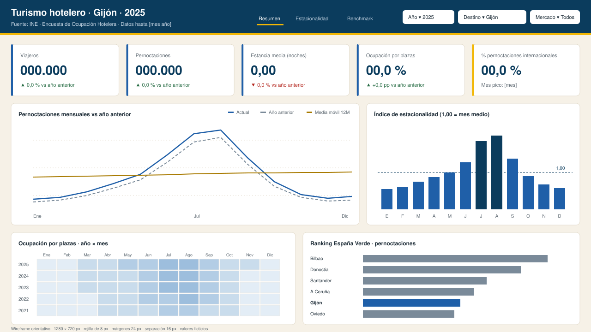

# Guía de uso · Dashboard de Turismo Hotelero en Gijón

Esta guía explica cómo **descargar, abrir, actualizar y usar** el informe, y qué hacer si algo falla. No necesitas saber DAX ni Power Query para seguirla.

> ¿Quieres entender cómo está construido por dentro o rehacerlo desde cero? Eso está en la [guía de desarrollo](GUIA_DESARROLLO.md).

## Índice

1. [Requisitos](#1-requisitos)
2. [Descargar el proyecto](#2-descargar-el-proyecto)
3. [Abrirlo por primera vez](#3-abrirlo-por-primera-vez)
4. [Recorrido por el informe](#4-recorrido-por-el-informe)
5. [Tareas habituales](#5-tareas-habituales)
6. [Solución de problemas](#6-solución-de-problemas)
7. [Glosario](#7-glosario)

---

## 1. Requisitos

| Necesitas | Detalle |
|---|---|
| **Windows 10 u 11** | Power BI Desktop sólo existe para Windows. En Mac, usa una máquina virtual con Windows (Parallels, UTM…). |
| **Power BI Desktop** | Gratuito. Instálalo desde la [Microsoft Store](https://aka.ms/pbidesktopstore) (se actualiza solo) o desde la [web de Microsoft](https://www.microsoft.com/power-platform/products/power-bi/desktop). Usa una versión reciente. |
| **Conexión a Internet** | Los datos se descargan en el momento desde el INE. |
| Cuenta de Power BI | **No hace falta** para abrir y usar el informe en tu ordenador. Sólo para publicarlo en la web (ver [5.6](#56-publicarlo-en-el-servicio-de-power-bi)). |

## 2. Descargar el proyecto

**Opción A · Sin Git (la más sencilla)**

1. En la página principal del repositorio, pulsa el botón verde **`<> Code`** y después **Download ZIP**.
2. Haz clic derecho sobre el ZIP descargado y elige **Extraer todo…**
3. Extráelo en una ruta **corta**, por ejemplo `C:\Proyectos\`. Las carpetas del proyecto están muy anidadas, y una ruta larga (por ejemplo, dentro de *Descargas* y de *OneDrive*) puede superar el límite de 260 caracteres de Windows.

> ⚠️ No abras el proyecto desde dentro del ZIP sin extraerlo: Power BI no podrá leer las carpetas.

**Opción B · Con Git**

```bash
git clone https://github.com/GITHUB_USER/turismo-gijon-powerbi.git C:\Proyectos\turismo-gijon-powerbi
```

## 3. Abrirlo por primera vez

### 3.1 Abrir el archivo

Entra en la carpeta `powerbi` y haz doble clic en **`TurismoGijon.pbip`**.

El proyecto se abre **sin datos**: verás los gráficos vacíos. Es normal, porque los datos no se guardan en el repositorio (así pesa poco y siempre muestra la información más reciente).

> **Si Power BI Desktop no abre el archivo** o dice que el formato no es compatible: ve a *Archivo > Opciones y configuración > Opciones > Características en versión preliminar*, activa **Formato de proyecto de Power BI (.pbip)**, **Formato TMDL del modelo semántico** y **Formato de informe mejorado de Power BI (PBIR)**, pulsa *Aceptar* y reinicia Power BI Desktop. En las versiones más recientes ya vienen activados.

### 3.2 Cargar los datos

1. Pulsa **Inicio > Actualizar**.
2. Si aparece una ventana de **credenciales** para `https://www.ine.es` o `https://raw.githubusercontent.com`, elige **Anónimo** y pulsa **Conectar**. Son datos públicos: no hace falta usuario.
3. Si aparece una ventana de **niveles de privacidad**, selecciona **Público** en los dos orígenes y pulsa **Guardar**.
4. Espera. La primera carga descarga dos ficheros completos del INE (varios MB) y puede tardar uno o dos minutos.

Cuando termine, las tarjetas y los gráficos se llenarán con los datos de **Gijón** para el año **2025**.

### 3.3 Guardar

Pulsa **Archivo > Guardar**. Power BI guarda los cambios en los ficheros de texto del proyecto. Los datos descargados se guardan en una caché local que **no** se sube a GitHub.

## 4. Recorrido por el informe

El informe tiene **tres páginas**. Cambias de página con las pestañas de la parte inferior de Power BI Desktop.

Todas comparten la misma estructura: una **cabecera azul** con el título y la fuente, y los **filtros (segmentadores) arriba a la derecha**.



*Esquema orientativo de la página Resumen (los valores son ficticios).*

### 4.1 Página «Resumen»

Responde a la pregunta: **¿cómo va el turismo hotelero en el destino elegido?**

**Filtros de la cabecera**

| Filtro | Valor inicial | Qué hace |
|---|---|---|
| **Año** | 2025 | Elige el año que se analiza. |
| **Punto Turístico** | Gijón | Elige el destino (selección única). |
| **Mercado** | Todos | *Nacional*, *Internacional* o ambos. Afecta a viajeros y pernoctaciones; la ocupación hotelera no distingue mercados, así que no cambia. |

**Tarjetas de indicadores (KPI)**

| Tarjeta | Qué mide | Línea inferior |
|---|---|---|
| **Viajeros** | Personas alojadas en hoteles en el periodo | ▲/▼ y % de variación frente al mismo periodo del año anterior |
| **Pernoctaciones** | Noches de hotel en el periodo | ▲/▼ y % de variación interanual |
| **Estancia media** | Noches por viajero | ▲/▼ y % de variación interanual |
| **Grado de ocupación por plazas** | % de plazas hoteleras ocupadas | ▲/▼ en **puntos porcentuales** (pp) frente al año anterior |
| **% pernoctaciones internacionales** | Peso del turista residente en el extranjero | Mes con más pernoctaciones del periodo |

> **Lectura de la variación.** «▲ 4,2 % vs año anterior» significa que el valor es un 4,2 % mayor que en el mismo periodo del año anterior. Si el año elegido aún no está completo, la comparación se hace sólo con los mismos meses publicados del año anterior, para que sea justa.

**Gráficos**

| Gráfico | Cómo leerlo |
|---|---|
| **Pernoctaciones mensuales vs. año anterior** | Línea azul: año elegido. Línea gris: año anterior. Línea dorada: media de los últimos 12 meses, que elimina el efecto del verano y deja ver la tendencia de fondo. |
| **Índice de estacionalidad** | Cada barra compara un mes con el mes medio del año. **1,00** = mes normal; **2,00** = el doble de lo habitual. Sólo se calcula para años con los 12 meses publicados. |
| **Ocupación por plazas · año × mes** | Matriz con todos los años: cuanto más intenso el azul, más ocupación. **No** le afecta el filtro *Año*, para que puedas comparar años de un vistazo. |
| **Ranking España Verde** | Pernoctaciones de los seis destinos, con el destino foco (Gijón) en azul. **No** le afecta el filtro *Punto Turístico*, para que siempre veas la comparación completa. |

**Interacción:** haz clic en un elemento de un gráfico (por ejemplo, una barra de mes) para filtrar el resto de la página. Vuelve a hacer clic en él, o en una zona vacía del gráfico, para quitar el filtro.

### 4.2 Página «Estacionalidad»

Responde a la pregunta: **¿cuándo viene el turista y se está repartiendo mejor a lo largo del año?**

| Elemento | Cómo leerlo |
|---|---|
| Filtro **Punto Turístico** | Destino analizado (Gijón por defecto). |
| **Índice de estacionalidad por año y mes** | Una fila por año. Los meses con color más intenso concentran más turismo. Si con los años julio y agosto se aclaran y los meses de primavera y otoño se oscurecen, el destino se está **desestacionalizando**. |
| **Peso de julio y agosto** | % de las pernoctaciones del año que se concentran en temporada alta. Una tendencia **descendente** es buena noticia: menos dependencia del verano. |
| **Mercado emisor** | Reparto de las pernoctaciones de cada año entre turistas residentes en España y en el extranjero. |

### 4.3 Página «Benchmark»

Responde a la pregunta: **¿cómo se compara Gijón con su competencia directa?** Los destinos comparados son Gijón, Oviedo, Santander, Bilbao, Donostia-San Sebastián y A Coruña.

| Elemento | Cómo leerlo |
|---|---|
| Filtro **Año** | Año comparado (2025 por defecto). |
| **Pernoctaciones por destino** | Volumen de cada destino; Gijón en azul. |
| **Crecimiento interanual** | Qué destinos crecen más y cuáles pierden actividad respecto al año anterior. |
| **Estancia media vs. ocupación** | Cada burbuja es un destino. Más a la derecha = estancias más largas; más arriba = hoteles más llenos; burbuja más grande = más plazas hoteleras. |
| **Comparativa de destinos** | Tabla con todos los indicadores. Haz clic en la cabecera de una columna para ordenar por ella. |

### 4.4 Trucos útiles

- **Ver los datos de un gráfico:** pasa el ratón por encima, abre el menú **…** del gráfico y elige **Mostrar como tabla**.
- **Ampliar un gráfico:** botón **Modo de enfoque** (icono de flecha diagonal) en la esquina del gráfico.
- **Exportar los datos de un gráfico a Excel/CSV:** menú **…** > **Exportar datos**.
- **Navegación con teclado y lector de pantalla:** todos los gráficos tienen texto alternativo y un orden de tabulación definido. Usa `Tab` para moverte entre los elementos de la página.

## 5. Tareas habituales

### 5.1 Actualizar los datos cada mes

El INE publica la Encuesta de Ocupación Hotelera unas **tres o cuatro semanas después** de terminar cada mes. Para traer el último mes, abre el proyecto y pulsa **Inicio > Actualizar**. No hay que tocar nada más.

### 5.2 Analizar otro año o el año en curso

Cambia el filtro **Año**. Si eliges el año en curso, las comparaciones interanuales usan sólo los meses ya publicados (ver la nota de [4.1](#41-página-resumen)).

### 5.3 Añadir otra ciudad a la comparación

1. **Transformar datos > Editar parámetros**.
2. En **`pPuntosTuristicos`**, añade el nombre de la ciudad al final, separado por `;`. Ejemplo: `Gijón;Oviedo;Santander;Bilbao;Coruña;Sebastián;Vigo`.
   Debe coincidir con cómo la escribe el INE (basta con una parte del nombre). Comprueba la lista de «puntos turísticos» en [INEbase](https://www.ine.es/jaxiT3/Tabla.htm?t=2078).
3. Añade una fila para la ciudad en [`data/reference/ref_puntos_turisticos.csv`](../data/reference/ref_puntos_turisticos.csv) (comunidad, provincia, coordenadas y orden). Sin esa fila la ciudad también aparece, pero sin comunidad ni coordenadas.
4. **Cerrar y aplicar**, y después **Actualizar**.

### 5.4 Cambiar el destino principal

1. En [`data/reference/ref_puntos_turisticos.csv`](../data/reference/ref_puntos_turisticos.csv), pon `Sí` en la columna `EsFoco` del nuevo destino y `No` en Gijón. Así cambia la ciudad resaltada en azul en los rankings.
2. En cada página, selecciona el nuevo destino en el filtro **Punto Turístico** y guarda: esa selección pasa a ser la inicial.

### 5.5 Cambiar el inicio del histórico

**Transformar datos > Editar parámetros > `pFechaInicio`** (por defecto, 01/01/2015). El INE tiene datos desde 2005. Más años implican una carga algo más lenta.

### 5.6 Publicarlo en el servicio de Power BI

1. **Inicio > Publicar** y elige un área de trabajo. Necesitas una cuenta **profesional o educativa** de Microsoft; las cuentas personales (Gmail, Outlook.com) no pueden iniciar sesión en el servicio.
2. En el servicio, abre la configuración del **modelo semántico**:
   - *Credenciales del origen de datos*: **Anónimo** para los dos orígenes web.
   - *Actualización programada*: mensual, hacia el día 25. No se necesita puerta de enlace, porque todos los orígenes son públicos.
3. Opcional, si tu organización lo permite: en el informe publicado, **Archivo > Insertar informe > Publicar en la web** te da un enlace público para tu portfolio o LinkedIn.

### 5.7 Guardar una copia en un solo archivo (.pbix)

**Archivo > Guardar como**, tipo **Archivo de Power BI (.pbix)**. Útil para enviarlo por correo o adjuntarlo a una *Release* de GitHub. El `.pbix` no se sube al repositorio (está en el `.gitignore`).

### 5.8 Exportar a PDF

**Archivo > Exportar > Exportar a PDF** genera un PDF con todas las páginas, tal como se ven con los filtros actuales.

### 5.9 Hacer capturas para el README

Sigue las indicaciones de [`docs/screenshots/README.md`](screenshots/README.md): nombres de archivo, tamaño recomendado y cómo sustituir el esquema del README por las capturas reales.

## 6. Solución de problemas

| Síntoma | Causa probable | Solución |
|---|---|---|
| Power BI Desktop no abre el `.pbip` o dice que no es compatible | Versión antigua o características en versión preliminar desactivadas | Actualiza Power BI Desktop y activa los formatos de [3.1](#31-abrir-el-archivo). |
| Error al abrir: no encuentra archivos o carpetas | Proyecto abierto desde el ZIP o ruta demasiado larga | Extrae el ZIP en una ruta corta, como `C:\Proyectos\` ([2](#2-descargar-el-proyecto)). |
| Los gráficos siguen vacíos | Aún no se han cargado los datos | **Inicio > Actualizar** ([3.2](#32-cargar-los-datos)). |
| `Formula.Firewall` o un mensaje sobre «niveles de privacidad» | Los orígenes no tienen nivel de privacidad asignado | *Archivo > Opciones y configuración > Configuración de origen de datos*: asigna **Público** a `www.ine.es` y a `raw.githubusercontent.com`, y vuelve a actualizar. |
| Vuelve a pedir credenciales | Se guardaron unas credenciales distintas de *Anónimo* | En *Configuración de origen de datos*, elige el origen > **Borrar permisos**, y vuelve a actualizar eligiendo **Anónimo**. |
| Error `EsquemaINE: No existe ninguna columna que contenga…` | El INE ha cambiado las columnas o el identificador de la tabla | Revisa la tabla en INEbase. Si el INE ha publicado una tabla nueva, cambia `pTablaDemanda` o `pTablaOferta` en *Editar parámetros*. Detalles en la [guía de desarrollo](GUIA_DESARROLLO.md#11-inventario-de-fuentes). |
| Las tildes salen mal (`Gijón`) | Codificación del CSV | En la consulta `fnLeerTablaINE`, cambia `Encoding = 65001` por `Encoding = 1252`. |
| Una ciudad no aparece | Su nombre no coincide con el del INE | Revisa `pPuntosTuristicos` ([5.3](#53-añadir-otra-ciudad-a-la-comparación)). |
| Tarjetas en blanco para el año elegido | El INE aún no ha publicado datos de ese año o de ese mes | Elige un año anterior, o espera a la siguiente publicación. |
| El índice de estacionalidad sale vacío | El año no tiene los 12 meses publicados | Es intencionado: el índice sólo es fiable con el año completo. |
| La primera actualización tarda mucho | Descarga completa de las tablas del INE | Es normal la primera vez. Si da error de tiempo de espera, vuelve a actualizar. |
| La ocupación no cambia al filtrar por *Mercado* | El INE no desglosa la ocupación por mercado | Comportamiento esperado ([4.1](#41-página-resumen)). |

¿Algo que no aparece aquí? Abre una *Issue* en el repositorio con una captura del error.

## 7. Glosario

| Término | Significado |
|---|---|
| **Viajero** | Persona que se aloja una o más noches seguidas en el mismo hotel. |
| **Pernoctación** | Cada noche que un viajero pasa en el hotel. |
| **Estancia media** | Pernoctaciones ÷ viajeros: noches que se queda, de media, cada viajero. |
| **Grado de ocupación por plazas** | Porcentaje de las plazas hoteleras disponibles en el mes que se han ocupado. |
| **pp (puntos porcentuales)** | Diferencia entre dos porcentajes. Pasar del 24 % al 26,5 % es **+2,5 pp** (y un +10,4 %). |
| **Variación interanual** | Cambio frente al mismo periodo del año anterior. |
| **Media móvil 12 meses** | Media de los últimos 12 meses; suaviza la estacionalidad para ver la tendencia. |
| **Índice de estacionalidad** | Valor de un mes ÷ media mensual del año (1,00 = mes medio). |
| **Temporada alta** | Julio y agosto. Media: junio y septiembre. Baja: el resto. |
| **Punto turístico** | Municipio con suficiente oferta hotelera para que el INE publique datos propios. |
| **España Verde** | Comunidades de la cornisa cantábrica: Galicia, Asturias, Cantabria y País Vasco. |

---

*Fuente de los datos: Instituto Nacional de Estadística (INE), Encuesta de Ocupación Hotelera. Elaboración propia.*
